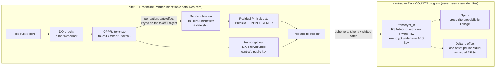
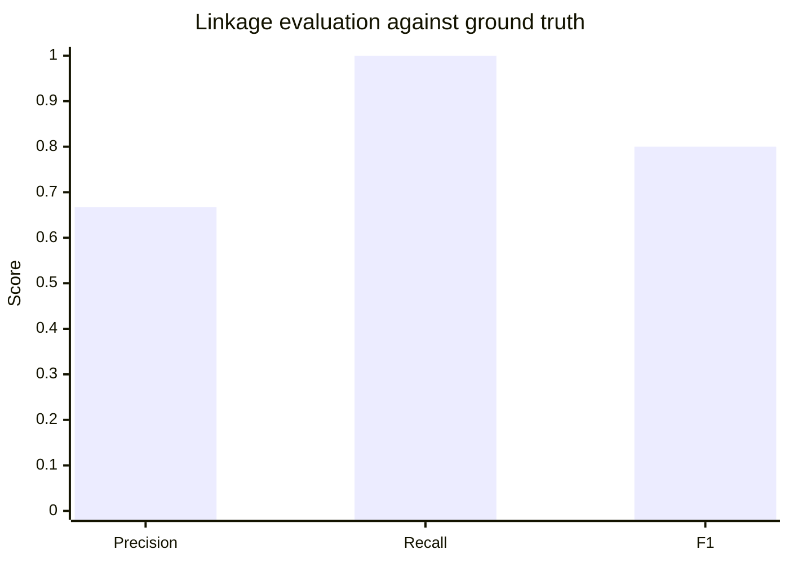

# Data COUNTS Leave-Behind POC — Report

**SYNTHETIC DATA ONLY. No real PHI was generated, stored, or processed anywhere in this project.**

A proof-of-concept in support of a response to NIH RFI **75N95C26R00005 (Data COUNTS™)**. This
report walks through the architecture, exercises each RFI requirement with a concrete example,
and reports the actual measured results of the cross-site linkage evaluation — not projected
numbers, the output of a real run.

## 1. Architecture: two projects, one protocol

The POC is split into two independently deployable projects that share no runtime dependency —
only a protocol. This mirrors the RFI's own language almost verbatim: Req 13 requires that
"identifiable processing is confined to the Healthcare Partner's VM and institutional trust
boundary; only de-identified, tokenized output is transmitted," and Req 5 requires "consistent
tokens across independently deployed, site-local instances... without introducing a shared trust
boundary."



Tokenization runs *before* de-identification, which is the opposite of the intuitive order and is
deliberate: tokenization needs the raw identifiers de-identification removes, and — since this pass
— the date shift is derived from the token digest, so the offset must exist before the stage that
applies it (§5b).

`site/` never holds the central platform's private key and cannot compute what its own tokens
resolve to. `central/` never holds a raw name, birth date, or any of the 18 HIPAA identifiers.
Each project independently re-implements the OPPRL v2 protocol (`site/src/data_counts/
stage6_pprl.py` and `central/src/data_counts_central/crypto.py`) — deliberately not shared code —
so that interoperability is a property of both implementations being protocol-conformant, not of
sharing a library at runtime. It also means each project's dependency footprint reflects what it
actually does: `central/` never installs PyTorch, transformers, GLiNER, Presidio, spaCy, or
Philter, because resolving and linking tokens never requires touching a raw identifier.

## 2. RFI requirement coverage

What follows is what an actual run produces, per requirement. It is deliberately not the complete
coverage picture: **[`REQUIREMENTS.md`](REQUIREMENTS.md) is the authoritative index**, keyed by RFI
requirement number, and it additionally carries the architecture-only requirements (7, 10, 12, 14),
an explicit `implemented` / `partial` / `architecture-only` status per requirement, the named gap
behind every `partial`, and a Known divergences section listing where this POC and the write-up
knowingly disagree. A test (`site/tests/test_requirements_sync.py`) asserts that index agrees with
what `make demo` prints, so the two can't drift.

| Req | Where | Example from an actual run |
|---|---|---|
| 1a | `stage1_synthea.py`, `stage2_ingest.py` | 100-patient synthetic cohort generated, landed as nested Parquet |
| 1b, 9 | `audit.py`, `stage9_audit.py` | Every stage appends `{timestamp, stage_id, batch_id, record_counts, outcome, reconciliation_status}` to `data/work/audit_log.jsonl` |
| 2 | `drs.py`, `stage3_drs.py` | `drs/examples/DC-POC-0001.json` validated; missing/ambiguous fields flagged, never silently substituted |
| 3 | `stage4_dq_kahn.py` | Kahn-framework checks (completeness, uniqueness, data type, date sequencing, records-per-patient) — see §3 |
| 4 | `stage5_deid.py` | 18 identifiers removed, per-patient date-shift — see §4 for a real gap found and fixed here |
| 5 | `stage6_pprl.py` + `central/` | OPPRL v2 token1/2/3, cross-site Splink linkage — see §5, the core of this report |
| 6 | `stage2_ingest.py`, `fhir_views/*.json` | Lossless raw Parquet layer + traceable flat analytic views, round-trip tested |
| 8, 15 | `stage8_package.py` | Versioned, idempotent package to `outbox/`; refresh-cycle diffing |
| 11 | `stage9_audit.py`, `security_audit.py`, `hash_chain.py` (both projects) | Pinned model versions/hashes + DRS version logged; hash-chained CEF security audit log, tamper detection demonstrated — see §6 |
| 13 | `stage7_leak_gate.py` | Independent QA gate (Presidio + Philter + GLiNER); halts and routes to `review_queue/` on any hit |

## 3. Example: data-quality checks (Req 3)

A single run against the example DRS's five checks, over a 100-patient cohort:

| Check | Kahn category | Result |
|---|---|---|
| `comp_dob` — patient.birth_date completeness | completeness | pass |
| `uniq_patient` — patient.id uniqueness | conformance | pass |
| `dtype_value` — observation.value_quantity castable to double | conformance | pass |
| `dateseq_enc` — encounter period_start ≤ period_end | plausibility | pass |
| `rpp_obs` — observation records-per-patient in [1, 5000] | plausibility | pass |

All five passed on this run (`any_dq_anomaly: false` in `data/work/qa_manifest.json`); any
`on_fail: halt` check failing would stop the pipeline before de-identification runs, per Req 3's
"all anomalies must be reported before any permitted corrections are applied."

## 4. Example: a real de-identification gap, found and fixed (Req 4, 13)

While verifying that `birth_date` and `gender` remaining in de-identified output was what Req 4 asks
for — it is: `gender` isn't one of the 18 identifiers enumerated at §164.514(b)(2), and `birth_date`
is genuinely per-patient date-shifted (`1992-05-13` → `1990-05-23` on the current run, not left
untouched), which is the requirement's own language verbatim ("apply a per-patient date-shifting
specification that preserves temporal order") — inspecting the actual packaged output surfaced
something worse: every
outbound table carried a raw internal resource `id` right alongside the patient's token. For the
patient table, that `id` **was the exact un-tokenized value the token existed to replace**:

```
subject_token: 'UkD0wM/wgH6O...'                    <- the whole point of tokenization
id:            'synthetic-patient-00000'            <- ...sitting right next to the untokenized original
```

Root cause: the synthetic data generator built every child resource's id by string-concatenating
the raw patient id (`synthetic-patient-00001-cond-484714`), so the leak propagated through
reference fields too (`observation.encounter_id`). Fixed at the root (resource ids are now opaque
122-bit random values, no relationship to any patient identifier) and defensively in
`stage8_package.py` (which now excludes `id`/`__source_resource_id` from every outbound table on
principle, regardless of what a given id scheme happens to contain). See `site/README.md` §"Stage
8: a real de-identification gap" for the full writeup.

## 5. Cross-site linkage (Req 5): the core exercise

### 5.1 Why a single token isn't enough

OPPRL's classic design produces one deterministic hash per identity-attribute combination — it can
only ever answer *identical* or *not*. Real-world data has typos: `token1` (first-initial + exact
last name + gender + birth-date) breaks the instant a last name is misspelled at one site and not
the other. `token2` (soundex) and `token3` (metaphone) — added to this POC specifically to test
this — tolerate that class of noise:

```
tokenize_token1("John", "Smith", ...) != tokenize_token1("John", "Smyth", ...)   # breaks
tokenize_token2("John", "Smith", ...) == tokenize_token2("John", "Smyth", ...)   # soundex: same
tokenize_token3("John", "Smith", ...) == tokenize_token3("John", "Smyth", ...)   # metaphone: same
```

### 5.2 Turning three binary signals into one graded decision

A single exact-hash token still can't express "probably the same person." [Splink](https://moj-analytical-services.github.io/splink/)
(DuckDB backend — no Spark, no PyTorch) combines `token1`/`token2`/`token3` agreement/disagreement
into one match probability via a Fellegi-Sunter model, then clusters records whose pairwise match
probability clears a threshold. `central/`'s `linkage.py` hand-sets the match/non-match
probabilities per token (`token1` is the least noise-tolerant but most discriminating when it does
match; `token2`/`token3` are more tolerant but coarser) rather than EM-training them, since a
single linkage run doesn't have enough volume to fit reliably.

### 5.3 The actual demo dataset and what it's designed to show

`site/`'s `export-linkage-demo-sites` command builds two independently-keyed simulated sites
around five identities, chosen so the evaluation has something real to measure — not a trivial
100%/100%:

| Identity | Site A | Site B | What it tests |
|---|---|---|---|
| Jane Doe, F, 1980-05-12 | exact spelling | exact spelling | baseline: everything agrees |
| John Smith / Smyth, M, 1975-11-03 | "Smith" | "Smyth" | recall under noise — token1 disagrees, token2/3 must carry it |
| Alice Anders, F, 1990-01-01 | present | — | precision — must never link to anything |
| Bob Baker, M, 1985-06-15 | — | present | precision — must never link to anything |
| Jordan/Jorden Doe, M, 2001-03-15 (twins) | "Jordan" | "Jorden" | a genuine, honest limitation — see §5.5 |

### 5.4 Measured result

```
$ make linkage-demo
Resolved 2 site package(s): ['site_a', 'site_b']
            Linkage clusters
┏━━━━━━━━━━━━━━━┳━━━━━━┳━━━━━━━━━━━━━━━━┓
┃ cluster_id    ┃ size ┃ sites          ┃
┡━━━━━━━━━━━━━━━╇━━━━━━╇━━━━━━━━━━━━━━━━┩
│ site_a-__-a-0 │ 2    │ site_a, site_b │   <- Jane Doe: linked
│ site_a-__-a-1 │ 2    │ site_a, site_b │   <- Smith/Smyth: linked despite the typo
│ site_a-__-a-2 │ 1    │ site_a         │   <- Alice: correctly alone
│ site_a-__-a-3 │ 2    │ site_a, site_b │   <- Jordan/Jorden: linked (see §5.5)
│ site_b-__-b-2 │ 1    │ site_b         │   <- Bob: correctly alone
└───────────────┴──────┴────────────────┘

Linkage evaluation (synthetic-demo-only ground truth)
  precision: 0.667   recall: 1.000   F1: 0.800
  true positives:  [(a-0, b-0), (a-1, b-1)]     # Jane; Smith/Smyth
  false positives: [(a-3, b-3)]                 # Jordan/Jorden — the twins
  false negatives: []
```



### 5.5 Reading the result honestly

**Recall is perfect (1.0):** every true match was found, including the noisy Smith/Smyth pair —
this is `token2`/`token3` doing exactly the job they were added for. **Precision is 0.667, not
1.0**, because of the twins case: "Jordan Doe" and "Jorden Doe" share a last name, a first initial,
a birth date, and a gender — and their first names are phonetically identical (`jellyfish.soundex`
and `.metaphone` both agree). Every token this system computes agrees, so it links them, even
though they are genuinely two different people. This isn't a bug in the linkage logic; it's an
honest, known limitation of any token scheme this coarse — real twins, or any two people who share
a birth date and a phonetically similar name, will produce a false positive under `token1`/`2`/`3`
alone. A production deployment would need either a fourth, more discriminating token (e.g. one
incorporating SSN or a health-plan member ID, per the full OPPRL v2 spec's `token9`/`token10`,
which this POC doesn't implement) or a human review step for borderline clusters. Reporting a
0.667 precision instead of a rigged 1.0 is the point of including this case at all.

## 5b. Consistent date shifting across sites and across DRSs (Req 4)

Linkage is only half of a longitudinal answer. Once §5 has established that two sites' records
belong to one person, any interval measured *across* that join — time to treatment, length of stay,
survival duration, progression interval — is valid only if both sites shifted that person's dates
by the same number of days. They did not, before this pass: the shift was
`sha256(request_id : site_local_patient_id)`, and the site-local id is different at every site by
definition. Two linked records were therefore misaligned by an arbitrary offset, and the
de-identification step was silently invalidating the measure the linkage step existed to enable.

### 5b.1 Keying the shift on the identity, not the row

The offset is now derived from the **OPPRL `token1` plaintext digest** —
`sha512("birth_date:first_initial:gender:last_name")` over OPPRL's own normalized values. That
digest is the only quantity in the protocol that is *identical at every site for one person* and
*recoverable centrally*: it is exactly what `transcrypt_in` RSA-decrypts. It carries no clinical
content and no site-local identifier. Two independently keyed sites produce different tokens for
the same person (different site RSA keys, hence different AES key spaces) but the same digest, and
therefore the same shift — which is the assertion this whole change exists to make true, and is
tested as such (`site/tests/test_reproducibility.py::test_two_sites_with_different_rsa_keys_derive_the_same_shift`).

### 5b.2 Across DRSs: a delta, never a round trip through the true date

Each DRS gets its own symmetric shift key, derived by central from an undistributed
`central_shift_secret` and handed to responding sites out of band. So a site shifts by
`shift_drs`, and the same patient's dates under a second DRS are shifted by a different amount.
Central reconciles them:

```
SITE      stored  = true + shift_drs                 (shift_drs    = HKDF(drs_shift_key,   digest))
CENTRAL   delta   = shift_global − shift_drs          (shift_global = HKDF(central_secret,  digest))
          final   = stored + delta = true + shift_global
```

One individual therefore lands on one offset, `shift_global`, across every DRS and every site —
encounters, conditions, procedures, medications, observations, deaths, all of it.

The arithmetic matters as much as the outcome. The obvious implementation decrypts to `true`,
re-shifts, and deletes the intermediate; that has the central platform transiently holding true
calendar dates for every patient, and a deletion step is a weaker guarantee than never having
computed the value. The delta form subtracts *two offsets from each other* and never a date from a
date, so `true_date` is not an intermediate anywhere in `central/` — there is nothing to delete.
`central/…/ingest.py` says so in its module docstring, and it is a structural property a reader can
check by grep, not a claim resting on cleanup code running.

### 5b.3 Preserving seasonality: a lattice, not a uniform draw

The previous `max_days: 365` drew uniformly from ±365 days, which moves a January admission into
July. Any analysis of seasonal incidence, seasonal utilization, or respiratory-season trajectory was
broken by the de-identification step itself. The offset is now drawn from a lattice:

```
shift_days = 364·k + 7·j        k ∈ [−max_years, +max_years],  j ∈ [−jitter_weeks, +jitter_weeks]
```

**Every term is a whole number of weeks**, and that is load-bearing rather than tidy. 364 = 52
weeks, so a whole-year component rotates the calendar without rotating the week; 365 would advance
the weekday by one per year of offset. The jitter is quantized to weeks for the same reason — a
day-granular jitter leaves the offset bounded but turns Friday into Thursday, voiding the guarantee
the 52-week quantum exists to provide. (This was a real bug in the first cut of this design; the
test that asserts `shift % 7 == 0` is what caught it.)

What that buys, at the defaults `max_years: 3, jitter_weeks: 2`:

| Property | Preserved |
|---|---|
| Day of the week | **Exactly**, for every offset the function can return |
| Day of the year | To within ≤ 18 days (jitter plus accumulated leap drift, ~1.25 days per year of offset) |
| Every day-count interval | **Exactly** — one offset per patient applied to every date of that patient |
| Age at event | **Exactly** — `birth_date` shifts by the same amount as every clinical date |
| Event sequencing | **Exactly** — a single additive offset is monotone |
| Calendar month | **Not claimed.** Under ±2 weeks of jitter a date late in a month provably crosses into the next one. The supported claim is bounded day-of-year drift, which keeps an event in its season |

### 5b.4 What this costs, stated plainly

**Date shifting here is not a confidentiality control.** A season-preserving offset is inherently
low-entropy: the lattice above admits 7 × 5 = **35 possible offsets** from the true date, and no
season-preserving scheme can have many more, since anything that moves a date far enough to be
unguessable has by definition moved it out of its season. (A measured run shows more distinct
*deltas* than that — 113 on the 1000-patient demo — but a delta is the difference of two lattice
points, `shift_global − shift_drs`; the quantity an adversary must guess is the 35-valued final
offset, so 35 is the honest number.) The design obscures calendar anchoring and nothing more. The
confidentiality claim rests on identifier removal (Req 4) and tokenization (Req 5, bounded in §9),
not on this.

Two further limitations, both recorded in `REQUIREMENTS.md`:

- **The shift is digest-exact; linkage is probabilistic.** Two records that Splink links via
  `token2`/`token3` (soundex/metaphone) despite differing `token1` digests — the Smith/Smyth pair of
  §5.4 is exactly this case — get *different* `shift_global` values and remain misaligned after
  re-offset. Cross-site intervals are valid for exact-digest matches, not for the phonetically
  recovered ones. The alternative is a second re-offset pass keyed on the Splink cluster id, run
  after linkage rather than in the ingest path; it is named and not implemented.
- **The per-DRS shift key is a real secret held outside one site's boundary.** It is shared with
  every site responding to a DRS, and a holder who also has a candidate identity can recompute
  `shift_drs` and un-shift that DRS's packaged dates. It is not a token key and does not weaken
  §5's token consistency or §9's irreversibility bound, but it is the one secret in this design that
  crosses a trust boundary, and Req 5's "no shared trust boundary" language should be read with it
  in view. `central_shift_secret` is never distributed.

## 6. Tamper-evident audit logging (Req 11)

The RFI asks for two different things that are easy to conflate: Req 9's *processing* audit trail
(per-stage record counts/outcome/reconciliation — `audit_log.jsonl`) and Req 11's *security* audit
log (authentication, administrative actions, configuration changes, and security events, "protected
against unauthorized modification or deletion"). Both existed only as plain append-mode files until
this pass — meaning either could be edited or deleted with zero detection. Both are now hash-chained
(`hash_chain.py`, duplicated in each project the same way the OPPRL crypto is): every entry's hash
covers its own content plus the previous entry's hash, so any edit, deletion, reordering, or
truncation breaks the chain from that point forward.

```
$ make verify-logs
Processing audit log (Req 9):  {'ok': True, 'records_checked': 10, 'first_break_at': None}
Security audit log (Req 11):   {'ok': True, 'records_checked': 4,  'first_break_at': None}
Both logs verified intact.
```

Demonstrated, not just claimed: `tests/test_tamper_evidence.py` (both projects) edits a live log's
content in place and asserts `verify()` reports `ok: False` with the exact index of the broken
entry — the same check `make verify-logs` runs by hand found the deliberately-introduced edit
below during development of this feature:

```
$ sed -i '1s/"Condition": 182/"Condition": 5/' data/work/audit_log.jsonl
$ make verify-logs
Processing audit log (Req 9): {'ok': False, 'records_checked': 0, 'first_break_at': 0}
TAMPERING DETECTED
```

**Said plainly: tamper-evident, not tamper-proof.** A local file is not write-once storage; someone
with filesystem access to both the log and its small `.chainhead` sidecar file could, in principle,
recompute the whole chain to hide an edit. The sidecar living outside the log raises the bar — two
files have to be made consistent, not one — but it isn't cryptographic proof against a fully
capable local attacker. True write-once guarantees need external anchoring this laptop-scale POC
doesn't have.

The security log is emitted as CEF (Common Event Format) — natively parsed by Splunk, Microsoft
Sentinel, IBM QRadar, and ArcSight — so a Healthcare Partner's existing SIEM can tail the file
directly rather than this pipeline needing a bespoke connector per vendor. The two hash-chain
fields ride along as ordinary CEF custom extensions (`cs2`/`cs3`); a SIEM that doesn't recognize
them just indexes them as extra searchable fields.

## 7. Test coverage

| Project | Tests | Result |
|---|---|---|
| `site/` | 23 | all pass — DQ checks, PPRL determinism + phonetic tolerance, round-trip, reproducibility, leak-gate routing, tamper-evidence |
| `central/` | 10 | all pass — crypto (transcrypt_in correctness/determinism), evaluation (precision/recall/F1 on known confusion-matrix cases), Splink linkage integration, tamper-evidence |

## 8. What this POC deliberately does not claim

- `token1`/`2`/`3` are 3 of OPPRL v2's 13 defined token variants (the ones using name/gender/DOB);
  SSN- and email-based variants aren't implemented.
- Splink's match/non-match probabilities are hand-set, not EM-trained — appropriate for a
  small-volume demo, not a substitute for calibrating against real linkage volume.
- The twins false positive in §5.5 is real and expected to recur in production for any two
  people who share a birth date and a phonetically close name, absent a more discriminating token
  or a human review step.
- The hash-chained logs (§6) are tamper-*evident*, not tamper-*proof*: a local attacker with
  filesystem access to both the log and its chain-head sidecar could still hide an edit by
  recomputing the whole chain. Real write-once guarantees need external anchoring this POC doesn't have.
- **The output is not Safe Harbor de-identified**, and stage 5 does not claim it is. It removes all
  18 identifiers enumerated at §164.514(b)(2), which is necessary but not sufficient: §164.514(c)
  allows a re-identification code only if it is "not derived from or related to information about
  the individual," and a PPRL token is by construction a keyed hash of name/gender/DOB. Safe Harbor
  also requires dates be reduced to year only, where this pipeline day-shifts them to preserve
  temporal order per Req 4. Both are consequences of the program's own linkage (Req 5) and
  longitudinal-research goals, not gaps. The defensible characterizations are a **Limited Data Set**
  under a DUA (§164.514(e)) or **de-identified by Expert Determination** (§164.514(b)(1)) — an NIH
  program-level determination, which the write-up's §10 raises as an open question rather than
  assuming. See `site/src/data_counts/stage5_deid.py`'s module docstring.
- **The tokens are irreversible without the program's private key, and dictionary-attackable with
  it.** OPPRL's digest has no secret input, so "irreversible" is a statement about key custody, not
  about the hash. §9 states the bound precisely and names what does and does not mitigate it.
- **Date shifting is not a confidentiality control.** Preserving season bounds the offset to 35
  possible values (§5b.4), and no season-preserving scheme can do much better. It obscures calendar
  anchoring; it does not hide when something happened from someone who already knows roughly when.
  Its two further limits — the shift is digest-exact where linkage is probabilistic, and the
  per-DRS shift key is a real secret outside a single site's boundary — are in §5b.4.

## 9. Threat model: what the tokens do and do not protect

Reviewers who know PPRL will ask what an adversary holding the program's key can actually recover
from the tokens. This section answers it directly, because the honest answer is narrower than the
word "irreversible" implies, and because the limit is a property of the OPPRL protocol itself
rather than of this POC's implementation of it.

### 9.1 The digest has no secret input

Each token is built in `site/src/data_counts/stage6_pprl.py` (`_tokenize`):

```python
plaintext = ":".join(values)          # e.g. "1974-03-08:J:M:SMITH"
digest = hashlib.sha512(plaintext.encode()).digest()
ciphertext = AESGCMSIV(aes_key).encrypt(_ZERO_NONCE, digest, None)
```

The AES layer is keyed. The digest underneath it is not: it is a plain SHA-512 over the normalized
attribute string, with no salt, no pepper, and no keyed MAC. This was verified against the
installed `spindle-token` 2.4.2 rather than assumed — the package's only two HKDF invocations
(`_crypto.py:156` and `opprl/v2.py:56`) both pass `salt=None`, and both derive the *AES* key, not
the digest. Nothing secret enters the hash at any point.

The normalization is equally public: `_normalize_name`, `_first_char`, `_normalize_gender`,
`_normalize_birth_date`, and the sorted-attribute-id join order are specified by OPPRL and
transcribed openly in `stage6_pprl.py`. Anyone can reconstruct the exact preimage string for a
candidate person.

### 9.2 Where the digest is live, and what that means

`central/src/data_counts_central/crypto.py`'s `transcrypt_in` is where the digest exists in
cleartext:

```python
plaintext = priv.decrypt(base64.b64decode(ephemeral_token), OAEP(...))
ciphertext = AESGCMSIV(aes_key).encrypt(_ZERO_NONCE, plaintext, None)
```

Two statements. `plaintext` there holds the bare, unsalted digest of one patient's normalized
name/gender/DOB, in the central platform's process memory, once per token per row. The module's
own claim that this platform "never sees a raw identifier" is true as written — and is not the
property that matters. The digest is not PII; it is a stable, globally-recomputable *pointer into*
public PII.

The consequence is that **the attack is not brute force.** The nominal `token1` space (~36,500
birth dates × 26 initials × 3 genders × ~150,000 realistic surnames ≈ 4×10¹¹) is already within
reach of a single GPU at SHA-512 rates, but no adversary would bother. The practical attack is a
**known-plaintext roster match**: take a voter file, obituary scrape, or commercial broker dataset
carrying name + DOB + sex, compute one digest per row, and look the values up. That is *N* hashes
for *N* people — not a search of the space, a single pass over a list.

Note which direction this cuts for the three token variants. `token2` and `token3` are *more*
exposed than `token1`, not less: soundex and metaphone collapse each name field to a few thousand
codes, so their preimage space is small enough to enumerate exhaustively rather than needing a
roster at all. The noise tolerance that makes them valuable for linkage (§5.1) is the same
property that makes them cheaper to attack.

### 9.3 Why there is no pepper, and why that is not a defect

The textbook fix is to mix a secret into the digest. That is structurally unavailable here, and
the reason is Req 5's own language.

Linkage works only because independently deployed, independently keyed sites produce *identical*
digests for the same person — that is precisely what `transcrypt_in` resolves into one comparable
token space, and what §5.4's measured cross-site linkage demonstrates. A pepper would therefore
have to be a secret shared by every participating site. That is exactly the "shared trust boundary
outside the Healthcare Partner site" that Req 5 forbids, and it is why OPPRL layers keyed AES over
an unsalted digest instead of salting the digest itself.

So this is a property of the protocol the program has selected, not a bug in this POC's
transcription of it. The POC mirrors upstream `spindle-token` faithfully and should continue to;
changing the digest construction would break protocol conformance and, with it, the cross-site
token consistency Req 5 asks for. What follows is about bounding the exposure, not eliminating it.

### 9.4 One secret protects everything

The entire barrier rests on a single file: `central/keys/central_private_key.pem`. Nothing on the
site side is weakened by any of the above — `transcrypt_out` emits an RSA-OAEP envelope, which is
randomized and unattackable without that key.

That one key does double duty, and this is the sharpest edge in the current design.
`derive_aes_key_v2` derives the platform's *at-rest* AES key from the same RSA private key that
unwraps *inbound* ephemeral tokens. There is no defense in depth: reading that one PEM lets an
adversary (a) decrypt any intercepted ephemeral token to a digest, and (b) decrypt any resolved
token sitting in the platform's linkage tables back to the same digest — then roster-match either.
Compromise is total, retroactive, and covers every site simultaneously.

The mitigation is to derive the platform's internal AES key from a second, independent keypair
rather than from the RSA key it publishes to sites. That AES key is purely platform-internal —
nothing outside `transcrypt_in` and the linkage tables depends on its value — so the change is
protocol-conformant and turns a one-file compromise into a two-file one. **It is not implemented
in this POC**, and is listed as a named gap on Req 5 in `REQUIREMENTS.md`.

Two operational consequences follow regardless:

- The platform's **resolved token space must be access-controlled as identifiable data**, not as
  de-identified output. Anyone holding the key who can also read those tables can dictionary-attack
  them.
- Under §164.514, an unsalted digest of name/gender/DOB reads considerably more like a
  re-identification code under §164.514(c) than like de-identified data. This is the same root
  reason §8 declines the Safe Harbor claim for stage 5's output, and it points at the same
  resolution — Limited Data Set under a DUA, or Expert Determination at the program level. §8's
  final bullet has the full argument; §9 adds only that the token is the reason, and that the
  determination has to account for the central token space as well as the site's output.

### 9.5 Narrowing the `transcrypt_in` window

What is implemented: `transcrypt_in` wraps the decrypt/re-encrypt pair so that no failure between
them can carry the digest into a rendered traceback. The digest-bearing local is unbound in a
`finally`, and the replacement exception (`TranscryptError`) is raised *outside* the `except` block
so that `__context__` is never populated — `raise ... from None` would only suppress *rendering* of
the original while leaving the attribute readable by any handler that inspects it. Covered by
`central/tests/test_crypto.py::test_transcrypt_in_failure_leaks_no_digest_into_the_traceback`,
which forces the failure *after* the digest exists (a malformed AES key, not a malformed token —
the latter fails before there is anything to leak, and would pass vacuously).

That bounds what a traceback can leak. It does not bound what memory can, and the following are
**`architecture-only`** — deployment posture, not code in this repo:

- **Python cannot zeroize `bytes`.** Every digest lingers in the heap until garbage collection, and
  reaches swap or a core dump from there. Required posture: swap disabled (or encrypted), core
  dumps disabled, and `ptrace`/debugger attachment restricted. A local operator able to dump the
  ingest process's memory reads digests without touching the key at all — which is why this is
  posture and not an optimization.
- **The digest crosses a process-internal boundary once per row.** `transcrypt_in` is registered as
  a DuckDB Python scalar UDF in `ingest.py`, so each digest passes between Python and DuckDB per
  row, per token column.
- **Intermediates must not persist.** `ingest.py`'s `duckdb.connect()` sets neither
  `temp_directory` nor `memory_limit`, and Splink's DuckDB backend (`linkage.py`) holds resolved
  tokens and may spill to disk under memory pressure. A real deployment must pin both, on
  encrypted storage, and treat any spill as identifiable-data storage.
- **The only mitigation that closes the window rather than narrowing it** is to perform the RSA
  unwrap inside an HSM or KMS under a decrypt-only policy, ideally performing the AES re-encrypt
  within the same boundary, so the digest never enters application memory at all. This is the
  recommended production design and is not what the POC does.

### 9.6 Hardening baseline

The controls in §9.5 are not bespoke; they are ordinary hardening-baseline requirements, and the
program should expect them to be specified against published baselines rather than described
ad hoc. Framed generically — DISA STIG/SRG baselines and the corresponding NIST SP 800-53 control
families (AC, AU, IA, SC, SI) — rather than committed to specific benchmark IDs, since the
applicable revision is a deployment-time decision. This is **`architecture-only`** in the sense
`REQUIREMENTS.md` uses the term — posture and procedure rather than running code — with one
exception, flagged at the end of this section, where a baseline control and existing code already
meet.

Three baselines are in scope, and each maps onto something this POC already does:

- **General Purpose OS SRG / RHEL 9 STIG** — the host running either half of the pipeline. This is
  where §9.5's swap, core-dump, and `ptrace` controls live, along with FIPS-validated cryptographic
  module operation for the RSA/AES/SHA-2 primitives both projects use, and filesystem encryption
  for the temp/spill paths.
- **Container Platform SRG** — the podman runtime for the leave-behind artifact. The POC's existing
  posture already satisfies much of the intent structurally rather than by configuration: rootless
  and daemonless (no root-owned socket to operate it), no listening socket, and no exposed port, as
  claimed under Req 12a. The baseline adds image provenance and signature verification, read-only
  root filesystem, and dropped capabilities — of which only digest-pinning the base image is noted
  in `site/Containerfile` today.
- **Application Security and Development STIG** — the pipeline code itself, and the closest fit of
  the three. Its audit-generation and audit-protection requirements map directly onto the
  hash-chained CEF log already implemented for Req 11 (including that log's honestly-stated
  tamper-*evident*-not-tamper-*proof* limit, §6). Its key-management requirements map onto the
  custody question in §9.4. Its error-handling requirement — that diagnostics not disclose
  sensitive information — is precisely what §9.5's `TranscryptError` implements; that control is
  the one place in this section where the baseline and the code already meet.

The Database SRG is deliberately **not** claimed as applicable. DuckDB here is an embedded
in-process library, not a managed DBMS with its own accounts, listeners, or privilege model, so
most of that baseline's controls have no subject; the OS and application baselines above are where
the equivalent protections actually land.

## 10. Sizing: baseline, 2X, 5X compute/memory/storage (Req 14)

Req 14 asks for assumed volumes, throughput, and CPU/memory/storage at baseline/2X/5X. This section
states the volume assumption directly — a **10,000-patient daily extract** as baseline, 20,000 at
2X, 50,000 at 5X — and derives throughput/memory/storage from **measured** runs of this actual
pipeline against real MITRE Synthea output (the `smartonfhir/synthea` container path, not this POC's
pure-Python placeholder generator), not a projected model built from assumed per-record costs.

### 10.1 The daily-extract sizing unit: 10,000 patients/day

What recurs, every day, for the life of a Healthcare Partner's participation, is the incremental
extract — the volume this section's compute/memory/storage table sizes for, as distinct from the
one-time bulk-export backfill a partner does once at onboarding (§10.2).

Real Synthea patient histories span decades, not a day — routine-visit vitals and labs compound over
a patient's whole life, so a one-day extract has to be built by drawing one real encounter per
patient from their history and placing it on a shared date. `daily_sample.py`'s `build()`
(`data-counts build-daily-sample`) does this: one real encounter per patient (two for a ~1.5% subset,
matching the real measured rate of multi-encounter patient-days), re-dated onto one simulated day,
keeping each encounter's real class and resource content otherwise untouched. One synthetic clinical
note is attached per encounter (patient-identifier header + templated filler text, length drawn from
each encounter's real class against two published word-count figures — 642-word median for
WELLNESS/ambulatory/outpatient/emergency visits, 886-word average for inpatient — weighted by real
Synthea's own measured class mix, 41.3%/40.6%/12.3%/4.9%/0.9% respectively).

Run at a 10,000-patient target against a real-Synthea cohort:

| Resource type | Daily volume (baseline, 1 site) |
|---|---:|
| Patient | 10,000 |
| Encounter | 10,149 |
| Observation | 36,305 |
| Condition | 2,855 |
| MedicationRequest | 1,952 |
| **Total structured resources/day** | **61,261** |
| Free-text notes/day (1/encounter, avg 648 words) | 10,149 |

These are direct, measured counts from a real one-day sample — not a ratio applied to an annual or
lifetime figure. 2X/5X scale these linearly to 20,000/50,000 patients; Req 5's architecture is
multiple independently-deployed sites, so 2X/5X reads either as one site's daily volume growing, or
as N independent baseline-scale sites (§10.8 addresses the N-sites reading for `central/`).

### 10.2 One-time bulk-export backfill: from patient count to FHIR resource volume

A Healthcare Partner's one-time onboarding backfill exports each patient's *entire* history, not one
day — a different, much larger per-patient resource volume than §10.1's daily unit. Real Synthea's
resource-per-patient ratio, measured on an 11,463-patient full-history cohort:

| Resource type | Measured count (real Synthea, 11,463 patients) | Ratio per patient |
|---|---:|---:|
| Patient | 11,463 | 1.000 |
| Condition | 64,776 | 5.651 |
| Encounter | 277,686 | 24.225 |
| Observation | 1,017,966 | 88.805 |
| MedicationRequest | 50,781 | 4.430 |
| **Total** | **1,422,672** | **124.11** |

This ratio is ~9× the pure-Python generator's (14.0/patient) — real Synthea simulates a full
birth-to-present clinical history per patient, where the placeholder generator draws a handful of
encounters from small fixed ranges regardless of age. **This is the more defensible number for
sizing a real bulk export.**

A partner's actual backfill scales with their real patient roster: at this measured ratio, an
N-patient roster backfills to roughly **124.11×N total FHIR resources** (e.g., a 100,000-patient
roster: ~12.4M resources, ~6.75GB packaged at §10.7's measured 544.30 bytes/resource — 54 seconds on
a 1 Gbps link, 9 minutes on 100 Mbps). This is a one-time onboarding cost, not part of the recurring
daily figures in §10.4.

### 10.3 Measured throughput, this machine (large-scale benchmark)

Hardware: 12-core AMD Ryzen AI 5 PRO 340 laptop, 27GB RAM — the same laptop-scale hardware named
throughout this report. The pipeline is single-process and largely sequential across stages (DuckDB
parallelizes internally; measured CPU utilization during the run was ~117% of one core, i.e. barely
more than single-threaded).

Per-stage rate, measured on a 1,422,672-resource / 11,463-patient real-Synthea full-history run
(§10.2's backfill-scale cohort, not the daily-extract sample), stages 2 through 8 run directly:

| Stage | Measured time | Rate |
|---|---:|---:|
| Stage 2 — ingest (raw Parquet + views) | 105.4s | 13,504 resources/sec |
| Stage 5/6 — OPPRL tokenization | 4.9s | 2,326 patients/sec |
| Stage 6/5 — de-identification | 94.2s | 15,097 rows/sec |
| Stage 8 — package | 0.9s | — |
| **End-to-end (stages 2+5+6+8 combined)** | **205.4s** | **55.8 patients/sec** |
| Peak RSS (single unchunked process, `/usr/bin/time -v`) | **9.83GB** | — |

This large-scale run is what a real onboarding backfill (§10.2) looks like computationally: at this
rate, a 100,000-patient backfill's ~12.4M structured resources would take roughly 15 minutes of
structured-stage compute, single-process, unchunked — well past the point where sharding would
actually be needed for a much larger roster (§10.5).

Stage 7's leak-gate scan is sub-second at this volume, not because it's free, but because this
full-history cohort carries no free-text notes to scan — §10.6 measures that case separately, against
the daily-extract sample, not this backfill-scale one.

**Synthea's own generation time is excluded from the rates above, deliberately** — production sizing
is about processing an already-exported bulk feed, not regenerating one, and real Synthea's
generation cost is not even linear in population to begin with: a 2,000-patient calibration run
generated at ~44 patients/sec, and an 11,463-patient run averaged only ~13.6 patients/sec. That
non-linearity is a property of Synthea's own demo-data generation, not of this pipeline's stages.

### 10.4 Compute, memory, and storage at baseline / 2X / 5X (the RFI table)

Structured-stage rates measured directly against §10.1's 10,000-patient one-day sample (61,261
structured resources), not scaled from the different-shaped backfill run in §10.3:

| Stage | Measured time (baseline) | Rate |
|---|---:|---:|
| Ingest (raw Parquet + views) | 7.4s | 8,304 resources/sec |
| OPPRL tokenization | 5.1s | 1,946 patients/sec |
| De-identification | 4.8s | 12,663 rows/sec |
| Package | 0.2s | — |
| **Structured stages combined** | **17.5s** | — |
| Peak RSS, structured stages combined | **0.79GB** | measured, `/usr/bin/time -v` |

Free-text note scan (§10.6), measured on the same daily sample's notes: **1.255 notes/sec, 819.7
words/sec**, peak RSS **1.26GB**.

| | Baseline (61,261 resources + 10,149 notes/day) | 2X (122,522 + 20,298) | 5X (306,305 + 50,745) |
|---|---:|---:|---:|
| **Compute — structured stages** | ~18 seconds | ~35 seconds | ~88 seconds |
| **Compute — note scan** | 2.25 hours | 4.49 hours | 11.23 hours |
| **Memory, peak** | ~1.26GB | ~1.26GB | ~1.26GB |
| **Storage — site-local lake growth** (464.73 bytes/resource, measured) | 28.5MB/day | 56.9MB/day | 142.3MB/day |
| **Storage — site-local lake, steady state at 90-day retention** | 2.56GB | 5.12GB | 12.81GB |
| **Transmitted `outbox/` package/day** (544.30 bytes/resource, measured) | 33.3MB/day | 66.7MB/day | 166.7MB/day |

Reading the table: at daily scale, the structured stages and storage never stress a single Healthcare
Partner site's hardware — structured-stage compute stays under two minutes even at 5X, and daily
storage growth stays in the tens-to-low-hundreds of megabytes. **For the N-independent-sites reading,
the baseline column is each site's number, unchanged at 2X/5X** — a busier or additional site doesn't
make any one site's daily job larger; it just means more sites are each independently running the
baseline row.

**The note-scan row is the compute driver, and the one that stops fitting comfortably at scale.**
Baseline (2.25 hours) and 2X (4.49 hours) fit an overnight batch window; **5X (11.23 hours) is close
to a full day**, not a comfortably nightly job, on this one node's single-threaded rate.

**Memory is dominated by the note-scan stage's one loaded model copy (1.26GB), not by resource
volume** — the structured-stage peak (0.79GB) is smaller and, since the pipeline runs its stages
sequentially in one process, the overall peak at any scale in this table is the note-scanner's figure,
not the sum of the two. Memory was never the binding constraint here at any of these three volumes.

**Storage — transmitted package is larger per resource than site-local lake growth (544.30 vs 464.73
bytes/resource), which looks backwards at first — the outbox's tokenized columns carry three
RSA-OAEP-encrypted values per row, and encrypted ciphertext doesn't compress, while the site-local
lake's raw lossless layer is repetitive real-world FHIR JSON (shared code systems, boilerplate
structure) that Parquet's columnar compression handles well.** Both figures are real, directly
measured against the same 61,261-resource sample, not estimates.

### 10.5 What this sizing does and does not claim

- **These are real measurements of this POC's actual code against real Synthea output** (§10.3,
  §10.4, §10.6), not a projected model built from assumed per-record costs. A production deployment's
  actual per-record cost will still differ with real (non-synthetic) data shapes, real storage
  backends, and real hardware.
- **10,000 patients/day is a stated assumption, not derived from a published health system's
  volume.** Req 14 asks for "assumed volumes" explicitly; this section states its assumption plainly
  rather than deriving one from an external source.
- **Sharding remains necessary for a large one-time bulk backfill, not for daily operation.** §10.3's
  100,000-patient backfill illustration is well within what this POC's unchunked stages handle in
  minutes; a much larger roster would eventually need the shard-and-parallelize approach this POC's
  stages don't implement today (`stage2_ingest.py`/`stage5_deid.py`/`stage6_pprl.py` each load a
  working set into memory per stage, not a streamed/chunked read) — but the recurring daily job in
  §10.4 never approaches a scale where that matters.
- **Retention is prescribed, not implemented.** No stage in this repo prunes `data/lake/` by age
  (`grep -rn retention site/src/data_counts/` finds nothing); the 90-day steady-state figures in
  §10.4 are the sizing conclusion a retention/pruning job (keyed on `refresh_id` or ingest timestamp)
  would need to realize, not a feature that exists today.
- **The free-text scan's note volume/length assumption comes from published research, not measured
  production note text** (§10.6's methodology) — a real note corpus's true PHI density and note-type
  mix would still move the exact hours in §10.4's note-scan row, though not its order of magnitude
  (NLP inference measured in notes/sec, not thousands of resources/sec like the structured stages).

### 10.6 The cost of scanning real free-text notes (Req 3, 9, 13)

Stage 7's leak gate (Presidio + Philter + GLiNER, Req 3/9/13) is the compute driver behind §10.4's
note-scan row. `stage7_leak_gate.run()` takes a `note_text` field neither Synthea nor this POC's
pure-Python fallback populates, so measuring its real cost requires actually giving it text to scan.

**Methodology.** Real clinical note volume/length has no equivalent in this repo's own data to
measure directly, so the length and per-encounter volume assumptions come from published research:
- **Length, weighted by real encounter class:** outpatient progress notes averaged 401 words in 2009,
  rising to a 642-word median by 2018 at one academic medical center
  ([Rule et al., PMC8290305](https://www.ncbi.nlm.nih.gov/pmc/articles/PMC8290305/)); inpatient
  progress notes averaged 886 words in a separate study
  ([PMC8529482](https://www.ncbi.nlm.nih.gov/pmc/articles/PMC8529482/)). Real Synthea's own
  encounter-class mix (measured on 26,803 encounters: 41.3% WELLNESS, 40.6% ambulatory, 12.3%
  outpatient, 4.9% emergency, 0.9% inpatient) means the 642-word outpatient figure is the right anchor
  for nearly all of it; this section weights each sampled encounter's note length by its real `class`
  (no ED-specific published figure was found, so outpatient is used as a stated placeholder for that
  4.9%; 886 words applies to the 0.9% that are inpatient).
- **Volume:** conservatively **1 note per encounter**. This almost certainly *undercounts* — the same
  research found a median of 359 notes per ED encounter by 2022, driven by copy-forward documentation
  ([Adler-Milstein et al., PMC11110617](https://www.ncbi.nlm.nih.gov/pmc/articles/PMC11110617/)) — but
  a defensible floor is more useful here than a number this section can't source as precisely.

**Measurement.** §10.1's daily sample (10,000 patients, 10,149 encounters, one real encounter per
patient re-dated onto a single simulated day) has one synthetic note attached per encounter, each
note's header pulling the *real* linked patient's name/DOB/phone via the real encounter→patient
reference, not a random unlinked identity. Full-corpus average length: 648.4 words/note. Scanning a
timed 1,000-note sample with all three detectors as `run()` actually invokes them (sample averaged
653.0 words/note, consistent with the full corpus): **1.255 notes/sec, 819.7 words/sec**, peak RSS
**1.26GB**. Every note in the sample correctly triggered a halt, as expected since the corpus
deliberately embeds an identifier header per note to force real NER work — production output (already
de-identified before stage 7 sees it) should not be expected to trigger one this often. This is the
rate §10.4's note-scan row is built from.

**Caveats, stated as plainly as §10.5's:** this is one measurement on synthetic, deliberately
identifier-dense text, on one machine, with one detector configuration — a production note corpus's
true PHI density and note-type mix (nursing notes are typically far shorter than discharge summaries)
would move the real number, though the order of magnitude (NLP inference measured in notes/sec, not
thousands of resources/sec like the structured stages) is unlikely to change.

**No GPU anywhere in this figure, or in this pipeline.** The measurement above ran on this laptop's
CPU alone, and that isn't a limitation of the test — it's the module's own design:
`stage7_leak_gate.py`'s docstring is explicit that GLiNER runs through `fast_gliner` (Rust + ONNX
Runtime, CPU-only), Presidio is spaCy-backed, and Philter is regex/POS-based — "no vLLM or any
generative-LLM serving stack anywhere." §10.4's note-scan hours are ordinary CPU-core hours, not GPU
hours: standard compute VMs, procurable at any cloud provider or on-prem, not the specialized (and
typically 5-15× more expensive per core-hour) GPU instances an LLM-based PHI scanner would require.
The whole pipeline — Req 14's compute story end to end, stage 7 included — is sized for a CPU-only
VM by design, matching Req 12a's minimal-attack-surface framing: no GPU driver stack, no CUDA
runtime, one fewer class of host dependency to patch and secure.

### 10.7 Upload time: what actually crosses the wire

Req 13's "only de-identified, tokenized output is transmitted" is architecturally load-bearing here:
`stage8_package.py` packages only the five structured domain tables (Req 1a's cohort), and this
pipeline has no transmission path for free-text notes at all — the leak gate exists to catch PHI that
has leaked *into a structured field*, not to clear narrative text for transmission, and §10.6's notes
never appear anywhere in `outbox/`. So the transmitted volume is the packaged `outbox/`, not
`data/lake/` (§10.4's site-local retention window) and not the note corpus.

**Measured, not assumed:** running the full structured pipeline against §10.1's 10,000-patient daily
sample (61,261 resources) produced an actual `outbox/` package of **33,344,595 bytes — 544.30
bytes/resource** — a real packaged Parquet+manifest deliverable. This is the rate §10.4's
transmitted-package row uses.

**Transfer time at the daily scale**, at three site-egress tiers (nominal link speed × 70% effective
throughput, a simplifying allowance for TLS/protocol overhead — not a measurement, a stated
assumption):

| | 100 Mbps (small site) | 1 Gbps (typical enterprise site) | 10 Gbps (large AMC backbone) |
|---|---:|---:|---:|
| Baseline (33.3 MB/day) | 3.2s | <1s | <1s |
| 2X (66.7 MB/day) | 6.3s | <1s | <1s |
| 5X (166.7 MB/day) | 15.9s | 1.6s | <1s |

Daily transmission stays well under a minute at any realistic bandwidth, at any of the 2X/5X
readings — the packaged output is small precisely because the raw lake's `__source_json` and nested
structure (§2, §10.4) never leave the site; only flat tokenized columns do. Transmission was never
going to be this pipeline's bottleneck at daily cadence; §10.4/§10.6's note-scan compute (hours,
depending on scale) dominates every one of these figures by orders of magnitude.

(§10.2's one-time onboarding backfill is a separate, larger transfer, scaling with the partner's
actual roster size at the same 544.30 bytes/resource rate — see §10.2's illustrative example.)

No stage in this repo actually performs a network transfer (the outbound path is a local `outbox/`
directory standing in for it, per `REQUIREMENTS.md`'s Req 12 row), so this section is sizing math
applied to a real measured artifact, not a benchmark of a real network call.

### 10.8 Does the 2X/5X multiplier apply to the central platform?

Everything through §10.7 sized one Healthcare Partner site's *daily* job. `central/` — the Data
COUNTS program's own platform — is a structurally different thing, and the RFI's baseline/2X/5X
framing doesn't map onto it the same way.

**There is no "API container" to replicate, yet.** `grep -rn fastapi central/` finds nothing;
`central/`'s three real operations (token resolution, date re-offset, linkage) are Typer CLI commands
invoked as batch jobs (`central/src/data_counts_central/cli.py`), not a running service. This matches
`REQUIREMENTS.md`'s own Req 15 gap note — the Program API is `architecture-only`. So the question as
posed has a premise to correct first: today's real deployment shape is a scheduled batch
ingest+linkage job, not a service that could be scaled by adjusting a replica count.

**Central's real per-day cost is the sum of what every site sends it, and at daily scale that sum
stays small.** Measured per-operation rates (real RSA/AES keys):

| Operation | Measured rate | Peak RSS | Parallelism model |
|---|---:|---:|---|
| `resolve_site_package` (transcrypt_in: RSA-OAEP decrypt + AES-GCM-SIV re-encrypt, per token) | 1,001.5 patients/sec | 232MB | **Embarrassingly parallel** — every row is independent |
| `reoffset_domain_tables` (per-row date-shift delta) | 4,943 rows/sec | 232MB | **Embarrassingly parallel** — same property, per row |
| `link_resolved_sites` (Splink/DuckDB, cross-site link_only run) | 11,479 rows/sec at this scale | 200MB | **Not arbitrary-replica-friendly** — see below |

These per-operation rates are properties of the crypto/dedup code itself (cost per token, per row),
not of the daily sample's patient/encounter mix, so they carry over directly to §10.1's 10,000-patient
baseline. Applied to §10.1's daily unit, fanning in from N independently-deployed sites each sending
their own baseline day:

| | 1 site (baseline) | 2 sites | 5 sites |
|---|---:|---:|---:|
| Patient touches/day (resolve workload) | 10,000 | 20,000 | 50,000 |
| **`resolve_site_package` time** | 10.0s | 20.0s | 50.0s |
| Structured resources/day (re-offset workload) | 61,261 | 122,522 | 306,305 |
| **`reoffset_domain_tables` time** | 12.4s | 24.8s | 62.0s |
| **`link_resolved_sites` time**, comparing that day's arrivals | 0.87s | 1.74s | 4.36s |

At daily-increment scale, central's resolve/re-offset/link workload never leaves single-digit seconds
regardless of site count — the two stateless operations are trivially absorbed by proportionally more
replicas if it ever mattered, and even cross-site linkage of a single day's arrivals is cheap.

**The real constraint linkage has is about the cumulative pool, not the daily increment, and it
doesn't disappear at this scale.** Splink blocks candidate pairs on `token2` (soundex) —
`linkage.py`'s own comment: "any pair sharing it becomes a scored candidate." That means the correct
unit of independent work is a *blocking-key partition*, not a request or a row: two records that
would match can be compared only if they land in the same partition, so replicas, if this were ever
run at scale, must be sharded by blocking-key value, not routed arbitrarily, or true cross-site
matches get silently missed. That constraint is invisible at the daily-increment scale in the table
above, because each day's new arrivals are small relative to any one blocking-key partition — but it
reappears the moment central builds or re-derives its full cumulative pool (a one-time onboarding
backfill or a full re-link after a schema change), where blocking-key partition size grows with the
*combined* pool of every site's resolved tokens, and comparison cost within a partition can grow
worse than linearly with partition size. Splink's own architecture reflects exactly this: its Spark
backend exists specifically to distribute blocking-group comparison work, and `central/` deliberately
doesn't use it (DuckDB only, single-process, per its own module docstring).

**So: the daily-increment multiplier is trivial for central; the real central sizing question is the
one-time (or periodic full-rebuild) cumulative-pool linkage, which needs deliberate
blocking-key-aware sharding (or Splink's Spark backend), not uniform replication.** A stateless
ingest/resolve/re-offset tier that scales linearly with daily site count, plus a linkage tier whose
real cost driver is cumulative pool size rather than any one day's increment — a two-tier deployment,
not a one-size answer, and not the same shape as the site-side daily sizing in §10.1–10.4.
