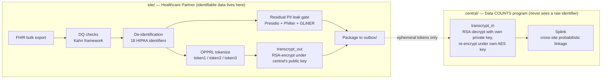
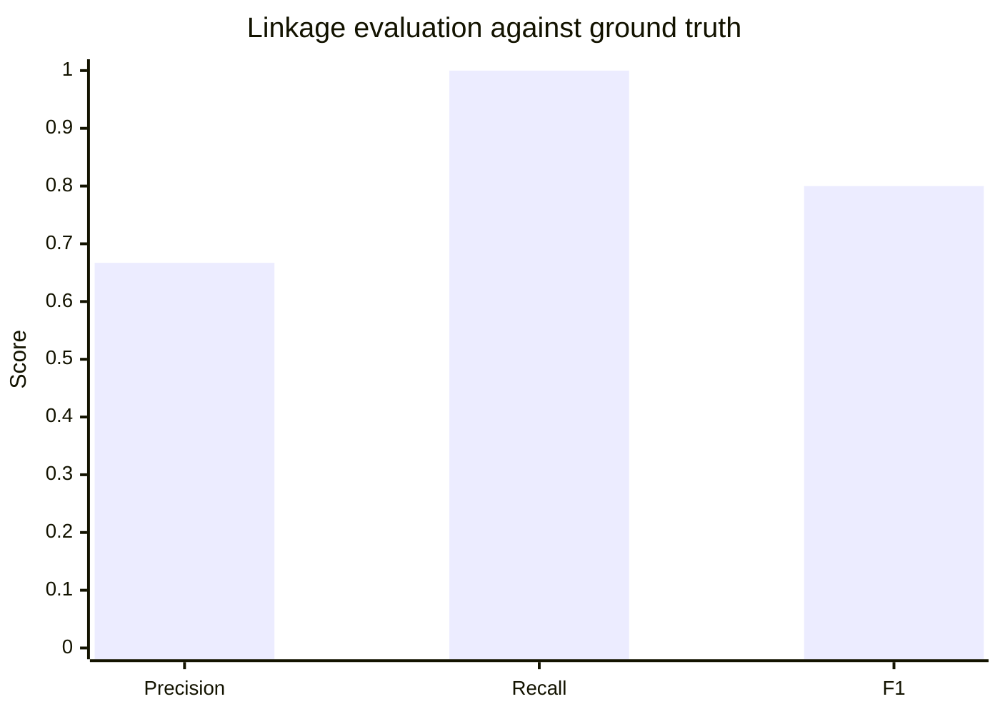

# Data COUNTS Leave-Behind POC — Report

**SYNTHETIC DATA ONLY. No real PHI was generated, stored, or processed anywhere in this project.**

A proof-of-concept in support of a response to NIH RFI **75N95C26R00005 (Data COUNTS™)**. This
report walks through the architecture, exercises each RFI requirement with a concrete example,
and reports the actual measured results of the cross-site linkage evaluation — not projected
numbers, the output of a real run.

## 1. Architecture: two projects, one protocol

The POC is split into two independently deployable projects that share no runtime dependency —
only a protocol. This mirrors the RFI's own language almost verbatim: Req 13 requires that
"identifiable processing is confined to the Healthcare Partner's VM and institutional trust
boundary; only de-identified, tokenized output is transmitted," and Req 5 requires "consistent
tokens across independently deployed, site-local instances... without introducing a shared trust
boundary."



`site/` never holds the central platform's private key and cannot compute what its own tokens
resolve to. `central/` never holds a raw name, birth date, or any of the 18 HIPAA identifiers.
Each project independently re-implements the OPPRL v2 protocol (`site/src/data_counts/
stage6_pprl.py` and `central/src/data_counts_central/crypto.py`) — deliberately not shared code —
so that interoperability is a property of both implementations being protocol-conformant, not of
sharing a library at runtime. It also means each project's dependency footprint reflects what it
actually does: `central/` never installs PyTorch, transformers, GLiNER, Presidio, spaCy, or
Philter, because resolving and linking tokens never requires touching a raw identifier.

## 2. RFI requirement coverage

| Req | Where | Example from an actual run |
|---|---|---|
| 1a | `stage1_synthea.py`, `stage2_ingest.py` | 100-patient synthetic cohort generated, landed as nested Parquet |
| 1b, 9 | `audit.py`, `stage9_audit.py` | Every stage appends `{timestamp, stage_id, batch_id, record_counts, outcome, reconciliation_status}` to `data/work/audit_log.jsonl` |
| 2 | `dsr.py`, `stage3_dsr.py` | `dsr/examples/DC-POC-0001.json` validated; missing/ambiguous fields flagged, never silently substituted |
| 3 | `stage4_dq_kahn.py` | Kahn-framework checks (completeness, uniqueness, data type, date sequencing, records-per-patient) — see §3 |
| 4 | `stage5_deid.py` | 18 identifiers removed, per-patient date-shift — see §4 for a real gap found and fixed here |
| 5 | `stage6_pprl.py` + `central/` | OPPRL v2 token1/2/3, cross-site Splink linkage — see §5, the core of this report |
| 6 | `stage2_ingest.py`, `fhir_views/*.json` | Lossless raw Parquet layer + traceable flat analytic views, round-trip tested |
| 8, 15 | `stage8_package.py` | Versioned, idempotent package to `outbox/`; refresh-cycle diffing |
| 11 | `stage9_audit.py`, `security_audit.py`, `hash_chain.py` (both projects) | Pinned model versions/hashes + DSR version logged; hash-chained CEF security audit log, tamper detection demonstrated — see §6 |
| 13 | `stage7_leak_gate.py` | Independent QA gate (Presidio + Philter + GLiNER); halts and routes to `review_queue/` on any hit |

## 3. Example: data-quality checks (Req 3)

A single run against the example DSR's five checks, over a 100-patient cohort:

| Check | Kahn category | Result |
|---|---|---|
| `comp_dob` — patient.birth_date completeness | completeness | pass |
| `uniq_patient` — patient.id uniqueness | conformance | pass |
| `dtype_value` — observation.value_quantity castable to double | conformance | pass |
| `dateseq_enc` — encounter period_start ≤ period_end | plausibility | pass |
| `rpp_obs` — observation records-per-patient in [1, 5000] | plausibility | pass |

All five passed on this run (`any_dq_anomaly: false` in `data/work/qa_manifest.json`); any
`on_fail: halt` check failing would stop the pipeline before de-identification runs, per Req 3's
"all anomalies must be reported before any permitted corrections are applied."

## 4. Example: a real de-identification gap, found and fixed (Req 4, 13)

While verifying that `birth_date` and `gender` remaining in de-identified output was compliant —
it is: `gender` isn't one of the 18 Safe Harbor identifiers, and `birth_date` is genuinely
per-patient date-shifted (`1992-05-13` → `1991-12-01`, not left untouched), which is exactly what
the RFI's Req 4 text asks for verbatim ("apply a per-patient date-shifting specification that
preserves temporal order") — inspecting the actual packaged output surfaced something worse: every
outbound table carried a raw internal resource `id` right alongside the patient's token. For the
patient table, that `id` **was the exact un-tokenized value the token existed to replace**:

```
subject_token: 'UkD0wM/wgH6O...'                    <- the whole point of tokenization
id:            'synthetic-patient-00000'            <- ...sitting right next to the untokenized original
```

Root cause: the synthetic data generator built every child resource's id by string-concatenating
the raw patient id (`synthetic-patient-00001-cond-484714`), so the leak propagated through
reference fields too (`observation.encounter_id`). Fixed at the root (resource ids are now opaque
122-bit random values, no relationship to any patient identifier) and defensively in
`stage8_package.py` (which now excludes `id`/`__source_resource_id` from every outbound table on
principle, regardless of what a given id scheme happens to contain). See `site/README.md` §"Stage
8: a real de-identification gap" for the full writeup.

## 5. Cross-site linkage (Req 5): the core exercise

### 5.1 Why a single token isn't enough

OPPRL's classic design produces one deterministic hash per identity-attribute combination — it can
only ever answer *identical* or *not*. Real-world data has typos: `token1` (first-initial + exact
last name + gender + birth-date) breaks the instant a last name is misspelled at one site and not
the other. `token2` (soundex) and `token3` (metaphone) — added to this POC specifically to test
this — tolerate that class of noise:

```
tokenize_token1("John", "Smith", ...) != tokenize_token1("John", "Smyth", ...)   # breaks
tokenize_token2("John", "Smith", ...) == tokenize_token2("John", "Smyth", ...)   # soundex: same
tokenize_token3("John", "Smith", ...) == tokenize_token3("John", "Smyth", ...)   # metaphone: same
```

### 5.2 Turning three binary signals into one graded decision

A single exact-hash token still can't express "probably the same person." [Splink](https://moj-analytical-services.github.io/splink/)
(DuckDB backend — no Spark, no PyTorch) combines `token1`/`token2`/`token3` agreement/disagreement
into one match probability via a Fellegi-Sunter model, then clusters records whose pairwise match
probability clears a threshold. `central/`'s `linkage.py` hand-sets the match/non-match
probabilities per token (`token1` is the least noise-tolerant but most discriminating when it does
match; `token2`/`token3` are more tolerant but coarser) rather than EM-training them, since a
single linkage run doesn't have enough volume to fit reliably.

### 5.3 The actual demo dataset and what it's designed to show

`site/`'s `export-linkage-demo-sites` command builds two independently-keyed simulated sites
around five identities, chosen so the evaluation has something real to measure — not a trivial
100%/100%:

| Identity | Site A | Site B | What it tests |
|---|---|---|---|
| Jane Doe, F, 1980-05-12 | exact spelling | exact spelling | baseline: everything agrees |
| John Smith / Smyth, M, 1975-11-03 | "Smith" | "Smyth" | recall under noise — token1 disagrees, token2/3 must carry it |
| Alice Anders, F, 1990-01-01 | present | — | precision — must never link to anything |
| Bob Baker, M, 1985-06-15 | — | present | precision — must never link to anything |
| Jordan/Jorden Doe, M, 2001-03-15 (twins) | "Jordan" | "Jorden" | a genuine, honest limitation — see §5.5 |

### 5.4 Measured result

```
$ make linkage-demo
Resolved 2 site package(s): ['site_a', 'site_b']
            Linkage clusters
┏━━━━━━━━━━━━━━━┳━━━━━━┳━━━━━━━━━━━━━━━━┓
┃ cluster_id    ┃ size ┃ sites          ┃
┡━━━━━━━━━━━━━━━╇━━━━━━╇━━━━━━━━━━━━━━━━┩
│ site_a-__-a-0 │ 2    │ site_a, site_b │   <- Jane Doe: linked
│ site_a-__-a-1 │ 2    │ site_a, site_b │   <- Smith/Smyth: linked despite the typo
│ site_a-__-a-2 │ 1    │ site_a         │   <- Alice: correctly alone
│ site_a-__-a-3 │ 2    │ site_a, site_b │   <- Jordan/Jorden: linked (see §5.5)
│ site_b-__-b-2 │ 1    │ site_b         │   <- Bob: correctly alone
└───────────────┴──────┴────────────────┘

Linkage evaluation (synthetic-demo-only ground truth)
  precision: 0.667   recall: 1.000   F1: 0.800
  true positives:  [(a-0, b-0), (a-1, b-1)]     # Jane; Smith/Smyth
  false positives: [(a-3, b-3)]                 # Jordan/Jorden — the twins
  false negatives: []
```



### 5.5 Reading the result honestly

**Recall is perfect (1.0):** every true match was found, including the noisy Smith/Smyth pair —
this is `token2`/`token3` doing exactly the job they were added for. **Precision is 0.667, not
1.0**, because of the twins case: "Jordan Doe" and "Jorden Doe" share a last name, a first initial,
a birth date, and a gender — and their first names are phonetically identical (`jellyfish.soundex`
and `.metaphone` both agree). Every token this system computes agrees, so it links them, even
though they are genuinely two different people. This isn't a bug in the linkage logic; it's an
honest, known limitation of any token scheme this coarse — real twins, or any two people who share
a birth date and a phonetically similar name, will produce a false positive under `token1`/`2`/`3`
alone. A production deployment would need either a fourth, more discriminating token (e.g. one
incorporating SSN or a health-plan member ID, per the full OPPRL v2 spec's `token9`/`token10`,
which this POC doesn't implement) or a human review step for borderline clusters. Reporting a
0.667 precision instead of a rigged 1.0 is the point of including this case at all.

## 6. Tamper-evident audit logging (Req 11)

The RFI asks for two different things that are easy to conflate: Req 9's *processing* audit trail
(per-stage record counts/outcome/reconciliation — `audit_log.jsonl`) and Req 11's *security* audit
log (authentication, administrative actions, configuration changes, and security events, "protected
against unauthorized modification or deletion"). Both existed only as plain append-mode files until
this pass — meaning either could be edited or deleted with zero detection. Both are now hash-chained
(`hash_chain.py`, duplicated in each project the same way the OPPRL crypto is): every entry's hash
covers its own content plus the previous entry's hash, so any edit, deletion, reordering, or
truncation breaks the chain from that point forward.

```
$ make verify-logs
Processing audit log (Req 9):  {'ok': True, 'records_checked': 10, 'first_break_at': None}
Security audit log (Req 11):   {'ok': True, 'records_checked': 4,  'first_break_at': None}
Both logs verified intact.
```

Demonstrated, not just claimed: `tests/test_tamper_evidence.py` (both projects) edits a live log's
content in place and asserts `verify()` reports `ok: False` with the exact index of the broken
entry — the same check `make verify-logs` runs by hand found the deliberately-introduced edit
below during development of this feature:

```
$ sed -i '1s/"Condition": 182/"Condition": 5/' data/work/audit_log.jsonl
$ make verify-logs
Processing audit log (Req 9): {'ok': False, 'records_checked': 0, 'first_break_at': 0}
TAMPERING DETECTED
```

**Said plainly: tamper-evident, not tamper-proof.** A local file is not write-once storage; someone
with filesystem access to both the log and its small `.chainhead` sidecar file could, in principle,
recompute the whole chain to hide an edit. The sidecar living outside the log raises the bar — two
files have to be made consistent, not one — but it isn't cryptographic proof against a fully
capable local attacker. True write-once guarantees need external anchoring this laptop-scale POC
doesn't have.

The security log is emitted as CEF (Common Event Format) — natively parsed by Splunk, Microsoft
Sentinel, IBM QRadar, and ArcSight — so a Healthcare Partner's existing SIEM can tail the file
directly rather than this pipeline needing a bespoke connector per vendor. The two hash-chain
fields ride along as ordinary CEF custom extensions (`cs2`/`cs3`); a SIEM that doesn't recognize
them just indexes them as extra searchable fields.

## 7. Test coverage

| Project | Tests | Result |
|---|---|---|
| `site/` | 23 | all pass — DQ checks, PPRL determinism + phonetic tolerance, round-trip, reproducibility, leak-gate routing, tamper-evidence |
| `central/` | 10 | all pass — crypto (transcrypt_in correctness/determinism), evaluation (precision/recall/F1 on known confusion-matrix cases), Splink linkage integration, tamper-evidence |

## 8. What this POC deliberately does not claim

- `token1`/`2`/`3` are 3 of OPPRL v2's 13 defined token variants (the ones using name/gender/DOB);
  SSN- and email-based variants aren't implemented.
- Splink's match/non-match probabilities are hand-set, not EM-trained — appropriate for a
  small-volume demo, not a substitute for calibrating against real linkage volume.
- The twins false positive in §5.5 is real and expected to recur in production for any two
  people who share a birth date and a phonetically close name, absent a more discriminating token
  or a human review step.
- The hash-chained logs (§6) are tamper-*evident*, not tamper-*proof*: a local attacker with
  filesystem access to both the log and its chain-head sidecar could still hide an edit by
  recomputing the whole chain. Real write-once guarantees need external anchoring this POC doesn't have.
