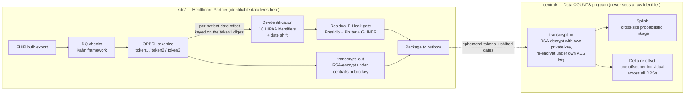
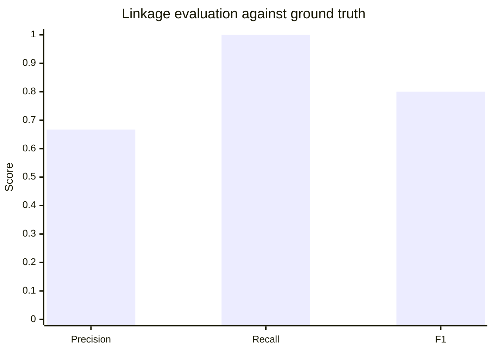

# Data COUNTS Leave-Behind POC — Report

**SYNTHETIC DATA ONLY. No real PHI was generated, stored, or processed anywhere in this project.**

A proof-of-concept in support of a response to NIH RFI **75N95C26R00005 (Data COUNTS™)**. This
report walks through the architecture, exercises each RFI requirement with a concrete example,
and reports the actual measured results of the cross-site linkage evaluation — not projected
numbers, the output of a real run.

## 1. Architecture: two projects, one protocol

The POC is split into two independently deployable projects that share no runtime dependency —
only a protocol. This mirrors the RFI's own language almost verbatim: Req 13 requires that
"identifiable processing is confined to the Healthcare Partner's VM and institutional trust
boundary; only de-identified, tokenized output is transmitted," and Req 5 requires "consistent
tokens across independently deployed, site-local instances... without introducing a shared trust
boundary."



Tokenization runs *before* de-identification, which is the opposite of the intuitive order and is
deliberate: tokenization needs the raw identifiers de-identification removes, and — since this pass
— the date shift is derived from the token digest, so the offset must exist before the stage that
applies it (§5b).

`site/` never holds the central platform's private key and cannot compute what its own tokens
resolve to. `central/` never holds a raw name, birth date, or any of the 18 HIPAA identifiers.
Each project independently re-implements the OPPRL v2 protocol (`site/src/data_counts/
stage6_pprl.py` and `central/src/data_counts_central/crypto.py`) — deliberately not shared code —
so that interoperability is a property of both implementations being protocol-conformant, not of
sharing a library at runtime. It also means each project's dependency footprint reflects what it
actually does: `central/` never installs PyTorch, transformers, GLiNER, Presidio, spaCy, or
Philter, because resolving and linking tokens never requires touching a raw identifier.

## 2. RFI requirement coverage

What follows is what an actual run produces, per requirement. It is deliberately not the complete
coverage picture: **[`REQUIREMENTS.md`](REQUIREMENTS.md) is the authoritative index**, keyed by RFI
requirement number, and it additionally carries the architecture-only requirements (7, 10, 12, 14),
an explicit `implemented` / `partial` / `architecture-only` status per requirement, the named gap
behind every `partial`, and a Known divergences section listing where this POC and the write-up
knowingly disagree. A test (`site/tests/test_requirements_sync.py`) asserts that index agrees with
what `make demo` prints, so the two can't drift.

| Req | Where | Example from an actual run |
|---|---|---|
| 1a | `stage1_synthea.py`, `stage2_ingest.py` | 100-patient synthetic cohort generated, landed as nested Parquet |
| 1b, 9 | `audit.py`, `stage9_audit.py` | Every stage appends `{timestamp, stage_id, batch_id, record_counts, outcome, reconciliation_status}` to `data/work/audit_log.jsonl` |
| 2 | `drs.py`, `stage3_drs.py` | `drs/examples/DC-POC-0001.json` validated; missing/ambiguous fields flagged, never silently substituted |
| 3 | `stage4_dq_kahn.py` | Kahn-framework checks (completeness, uniqueness, data type, date sequencing, records-per-patient) — see §3 |
| 4 | `stage5_deid.py` | 18 identifiers removed, per-patient date-shift — see §4 for a real gap found and fixed here |
| 5 | `stage6_pprl.py` + `central/` | OPPRL v2 token1/2/3, cross-site Splink linkage — see §5, the core of this report |
| 6 | `stage2_ingest.py`, `fhir_views/*.json` | Lossless raw Parquet layer + traceable flat analytic views, round-trip tested |
| 8, 15 | `stage8_package.py` | Versioned, idempotent package to `outbox/`; refresh-cycle diffing |
| 11 | `stage9_audit.py`, `security_audit.py`, `hash_chain.py` (both projects) | Pinned model versions/hashes + DRS version logged; hash-chained CEF security audit log, tamper detection demonstrated — see §6 |
| 13 | `stage7_leak_gate.py` | Independent QA gate (Presidio + Philter + GLiNER); halts and routes to `review_queue/` on any hit |

## 3. Example: data-quality checks (Req 3)

A single run against the example DRS's five checks, over a 100-patient cohort:

| Check | Kahn category | Result |
|---|---|---|
| `comp_dob` — patient.birth_date completeness | completeness | pass |
| `uniq_patient` — patient.id uniqueness | conformance | pass |
| `dtype_value` — observation.value_quantity castable to double | conformance | pass |
| `dateseq_enc` — encounter period_start ≤ period_end | plausibility | pass |
| `rpp_obs` — observation records-per-patient in [1, 5000] | plausibility | pass |

All five passed on this run (`any_dq_anomaly: false` in `data/work/qa_manifest.json`); any
`on_fail: halt` check failing would stop the pipeline before de-identification runs, per Req 3's
"all anomalies must be reported before any permitted corrections are applied."

## 4. Example: a real de-identification gap, found and fixed (Req 4, 13)

While verifying that `birth_date` and `gender` remaining in de-identified output was what Req 4 asks
for — it is: `gender` isn't one of the 18 identifiers enumerated at §164.514(b)(2), and `birth_date`
is genuinely per-patient date-shifted (`1992-05-13` → `1990-05-23` on the current run, not left
untouched), which is the requirement's own language verbatim ("apply a per-patient date-shifting
specification that preserves temporal order") — inspecting the actual packaged output surfaced
something worse: every
outbound table carried a raw internal resource `id` right alongside the patient's token. For the
patient table, that `id` **was the exact un-tokenized value the token existed to replace**:

```
subject_token: 'UkD0wM/wgH6O...'                    <- the whole point of tokenization
id:            'synthetic-patient-00000'            <- ...sitting right next to the untokenized original
```

Root cause: the synthetic data generator built every child resource's id by string-concatenating
the raw patient id (`synthetic-patient-00001-cond-484714`), so the leak propagated through
reference fields too (`observation.encounter_id`). Fixed at the root (resource ids are now opaque
122-bit random values, no relationship to any patient identifier) and defensively in
`stage8_package.py` (which now excludes `id`/`__source_resource_id` from every outbound table on
principle, regardless of what a given id scheme happens to contain). See `site/README.md` §"Stage
8: a real de-identification gap" for the full writeup.

## 5. Cross-site linkage (Req 5): the core exercise

### 5.1 Why a single token isn't enough

OPPRL's classic design produces one deterministic hash per identity-attribute combination — it can
only ever answer *identical* or *not*. Real-world data has typos: `token1` (first-initial + exact
last name + gender + birth-date) breaks the instant a last name is misspelled at one site and not
the other. `token2` (soundex) and `token3` (metaphone) — added to this POC specifically to test
this — tolerate that class of noise:

```
tokenize_token1("John", "Smith", ...) != tokenize_token1("John", "Smyth", ...)   # breaks
tokenize_token2("John", "Smith", ...) == tokenize_token2("John", "Smyth", ...)   # soundex: same
tokenize_token3("John", "Smith", ...) == tokenize_token3("John", "Smyth", ...)   # metaphone: same
```

### 5.2 Turning three binary signals into one graded decision

A single exact-hash token still can't express "probably the same person." [Splink](https://moj-analytical-services.github.io/splink/)
(DuckDB backend — no Spark, no PyTorch) combines `token1`/`token2`/`token3` agreement/disagreement
into one match probability via a Fellegi-Sunter model, then clusters records whose pairwise match
probability clears a threshold. `central/`'s `linkage.py` hand-sets the match/non-match
probabilities per token (`token1` is the least noise-tolerant but most discriminating when it does
match; `token2`/`token3` are more tolerant but coarser) rather than EM-training them, since a
single linkage run doesn't have enough volume to fit reliably.

### 5.3 The actual demo dataset and what it's designed to show

`site/`'s `export-linkage-demo-sites` command builds two independently-keyed simulated sites
around five identities, chosen so the evaluation has something real to measure — not a trivial
100%/100%:

| Identity | Site A | Site B | What it tests |
|---|---|---|---|
| Jane Doe, F, 1980-05-12 | exact spelling | exact spelling | baseline: everything agrees |
| John Smith / Smyth, M, 1975-11-03 | "Smith" | "Smyth" | recall under noise — token1 disagrees, token2/3 must carry it |
| Alice Anders, F, 1990-01-01 | present | — | precision — must never link to anything |
| Bob Baker, M, 1985-06-15 | — | present | precision — must never link to anything |
| Jordan/Jorden Doe, M, 2001-03-15 (twins) | "Jordan" | "Jorden" | a genuine, honest limitation — see §5.5 |

### 5.4 Measured result

```
$ make linkage-demo
Resolved 2 site package(s): ['site_a', 'site_b']
            Linkage clusters
┏━━━━━━━━━━━━━━━┳━━━━━━┳━━━━━━━━━━━━━━━━┓
┃ cluster_id    ┃ size ┃ sites          ┃
┡━━━━━━━━━━━━━━━╇━━━━━━╇━━━━━━━━━━━━━━━━┩
│ site_a-__-a-0 │ 2    │ site_a, site_b │   <- Jane Doe: linked
│ site_a-__-a-1 │ 2    │ site_a, site_b │   <- Smith/Smyth: linked despite the typo
│ site_a-__-a-2 │ 1    │ site_a         │   <- Alice: correctly alone
│ site_a-__-a-3 │ 2    │ site_a, site_b │   <- Jordan/Jorden: linked (see §5.5)
│ site_b-__-b-2 │ 1    │ site_b         │   <- Bob: correctly alone
└───────────────┴──────┴────────────────┘

Linkage evaluation (synthetic-demo-only ground truth)
  precision: 0.667   recall: 1.000   F1: 0.800
  true positives:  [(a-0, b-0), (a-1, b-1)]     # Jane; Smith/Smyth
  false positives: [(a-3, b-3)]                 # Jordan/Jorden — the twins
  false negatives: []
```



### 5.5 Reading the result honestly

**Recall is perfect (1.0):** every true match was found, including the noisy Smith/Smyth pair —
this is `token2`/`token3` doing exactly the job they were added for. **Precision is 0.667, not
1.0**, because of the twins case: "Jordan Doe" and "Jorden Doe" share a last name, a first initial,
a birth date, and a gender — and their first names are phonetically identical (`jellyfish.soundex`
and `.metaphone` both agree). Every token this system computes agrees, so it links them, even
though they are genuinely two different people. This isn't a bug in the linkage logic; it's an
honest, known limitation of any token scheme this coarse — real twins, or any two people who share
a birth date and a phonetically similar name, will produce a false positive under `token1`/`2`/`3`
alone. A production deployment would need either a fourth, more discriminating token (e.g. one
incorporating SSN or a health-plan member ID, per the full OPPRL v2 spec's `token9`/`token10`,
which this POC doesn't implement) or a human review step for borderline clusters. Reporting a
0.667 precision instead of a rigged 1.0 is the point of including this case at all.

## 5b. Consistent date shifting across sites and across DRSs (Req 4)

Linkage is only half of a longitudinal answer. Once §5 has established that two sites' records
belong to one person, any interval measured *across* that join — time to treatment, length of stay,
survival duration, progression interval — is valid only if both sites shifted that person's dates
by the same number of days. They did not, before this pass: the shift was
`sha256(request_id : site_local_patient_id)`, and the site-local id is different at every site by
definition. Two linked records were therefore misaligned by an arbitrary offset, and the
de-identification step was silently invalidating the measure the linkage step existed to enable.

### 5b.1 Keying the shift on the identity, not the row

The offset is now derived from the **OPPRL `token1` plaintext digest** —
`sha512("birth_date:first_initial:gender:last_name")` over OPPRL's own normalized values. That
digest is the only quantity in the protocol that is *identical at every site for one person* and
*recoverable centrally*: it is exactly what `transcrypt_in` RSA-decrypts. It carries no clinical
content and no site-local identifier. Two independently keyed sites produce different tokens for
the same person (different site RSA keys, hence different AES key spaces) but the same digest, and
therefore the same shift — which is the assertion this whole change exists to make true, and is
tested as such (`site/tests/test_reproducibility.py::test_two_sites_with_different_rsa_keys_derive_the_same_shift`).

### 5b.2 Across DRSs: a delta, never a round trip through the true date

Each DRS gets its own symmetric shift key, derived by central from an undistributed
`central_shift_secret` and handed to responding sites out of band. So a site shifts by
`shift_drs`, and the same patient's dates under a second DRS are shifted by a different amount.
Central reconciles them:

```
SITE      stored  = true + shift_drs                 (shift_drs    = HKDF(drs_shift_key,   digest))
CENTRAL   delta   = shift_global − shift_drs          (shift_global = HKDF(central_secret,  digest))
          final   = stored + delta = true + shift_global
```

One individual therefore lands on one offset, `shift_global`, across every DRS and every site —
encounters, conditions, procedures, medications, observations, deaths, all of it.

The arithmetic matters as much as the outcome. The obvious implementation decrypts to `true`,
re-shifts, and deletes the intermediate; that has the central platform transiently holding true
calendar dates for every patient, and a deletion step is a weaker guarantee than never having
computed the value. The delta form subtracts *two offsets from each other* and never a date from a
date, so `true_date` is not an intermediate anywhere in `central/` — there is nothing to delete.
`central/…/ingest.py` says so in its module docstring, and it is a structural property a reader can
check by grep, not a claim resting on cleanup code running.

### 5b.3 Preserving seasonality: a lattice, not a uniform draw

The previous `max_days: 365` drew uniformly from ±365 days, which moves a January admission into
July. Any analysis of seasonal incidence, seasonal utilization, or respiratory-season trajectory was
broken by the de-identification step itself. The offset is now drawn from a lattice:

```
shift_days = 364·k + 7·j        k ∈ [−max_years, +max_years],  j ∈ [−jitter_weeks, +jitter_weeks]
```

**Every term is a whole number of weeks**, and that is load-bearing rather than tidy. 364 = 52
weeks, so a whole-year component rotates the calendar without rotating the week; 365 would advance
the weekday by one per year of offset. The jitter is quantized to weeks for the same reason — a
day-granular jitter leaves the offset bounded but turns Friday into Thursday, voiding the guarantee
the 52-week quantum exists to provide. (This was a real bug in the first cut of this design; the
test that asserts `shift % 7 == 0` is what caught it.)

What that buys, at the defaults `max_years: 3, jitter_weeks: 2`:

| Property | Preserved |
|---|---|
| Day of the week | **Exactly**, for every offset the function can return |
| Day of the year | To within ≤ 18 days (jitter plus accumulated leap drift, ~1.25 days per year of offset) |
| Every day-count interval | **Exactly** — one offset per patient applied to every date of that patient |
| Age at event | **Exactly** — `birth_date` shifts by the same amount as every clinical date |
| Event sequencing | **Exactly** — a single additive offset is monotone |
| Calendar month | **Not claimed.** Under ±2 weeks of jitter a date late in a month provably crosses into the next one. The supported claim is bounded day-of-year drift, which keeps an event in its season |

### 5b.4 What this costs, stated plainly

**Date shifting here is not a confidentiality control.** A season-preserving offset is inherently
low-entropy: the lattice above admits 7 × 5 = **35 possible offsets** from the true date, and no
season-preserving scheme can have many more, since anything that moves a date far enough to be
unguessable has by definition moved it out of its season. (A measured run shows more distinct
*deltas* than that — 113 on the 1000-patient demo — but a delta is the difference of two lattice
points, `shift_global − shift_drs`; the quantity an adversary must guess is the 35-valued final
offset, so 35 is the honest number.) The design obscures calendar anchoring and nothing more. The
confidentiality claim rests on identifier removal (Req 4) and tokenization (Req 5, bounded in §9),
not on this.

Two further limitations, both recorded in `REQUIREMENTS.md`:

- **The shift is digest-exact; linkage is probabilistic.** Two records that Splink links via
  `token2`/`token3` (soundex/metaphone) despite differing `token1` digests — the Smith/Smyth pair of
  §5.4 is exactly this case — get *different* `shift_global` values and remain misaligned after
  re-offset. Cross-site intervals are valid for exact-digest matches, not for the phonetically
  recovered ones. The alternative is a second re-offset pass keyed on the Splink cluster id, run
  after linkage rather than in the ingest path; it is named and not implemented.
- **The per-DRS shift key is a real secret held outside one site's boundary.** It is shared with
  every site responding to a DRS, and a holder who also has a candidate identity can recompute
  `shift_drs` and un-shift that DRS's packaged dates. It is not a token key and does not weaken
  §5's token consistency or §9's irreversibility bound, but it is the one secret in this design that
  crosses a trust boundary, and Req 5's "no shared trust boundary" language should be read with it
  in view. `central_shift_secret` is never distributed.

## 6. Tamper-evident audit logging (Req 11)

The RFI asks for two different things that are easy to conflate: Req 9's *processing* audit trail
(per-stage record counts/outcome/reconciliation — `audit_log.jsonl`) and Req 11's *security* audit
log (authentication, administrative actions, configuration changes, and security events, "protected
against unauthorized modification or deletion"). Both existed only as plain append-mode files until
this pass — meaning either could be edited or deleted with zero detection. Both are now hash-chained
(`hash_chain.py`, duplicated in each project the same way the OPPRL crypto is): every entry's hash
covers its own content plus the previous entry's hash, so any edit, deletion, reordering, or
truncation breaks the chain from that point forward.

```
$ make verify-logs
Processing audit log (Req 9):  {'ok': True, 'records_checked': 10, 'first_break_at': None}
Security audit log (Req 11):   {'ok': True, 'records_checked': 4,  'first_break_at': None}
Both logs verified intact.
```

Demonstrated, not just claimed: `tests/test_tamper_evidence.py` (both projects) edits a live log's
content in place and asserts `verify()` reports `ok: False` with the exact index of the broken
entry — the same check `make verify-logs` runs by hand found the deliberately-introduced edit
below during development of this feature:

```
$ sed -i '1s/"Condition": 182/"Condition": 5/' data/work/audit_log.jsonl
$ make verify-logs
Processing audit log (Req 9): {'ok': False, 'records_checked': 0, 'first_break_at': 0}
TAMPERING DETECTED
```

**Said plainly: tamper-evident, not tamper-proof.** A local file is not write-once storage; someone
with filesystem access to both the log and its small `.chainhead` sidecar file could, in principle,
recompute the whole chain to hide an edit. The sidecar living outside the log raises the bar — two
files have to be made consistent, not one — but it isn't cryptographic proof against a fully
capable local attacker. True write-once guarantees need external anchoring this laptop-scale POC
doesn't have.

The security log is emitted as CEF (Common Event Format) — natively parsed by Splunk, Microsoft
Sentinel, IBM QRadar, and ArcSight — so a Healthcare Partner's existing SIEM can tail the file
directly rather than this pipeline needing a bespoke connector per vendor. The two hash-chain
fields ride along as ordinary CEF custom extensions (`cs2`/`cs3`); a SIEM that doesn't recognize
them just indexes them as extra searchable fields.

## 7. Test coverage

| Project | Tests | Result |
|---|---|---|
| `site/` | 23 | all pass — DQ checks, PPRL determinism + phonetic tolerance, round-trip, reproducibility, leak-gate routing, tamper-evidence |
| `central/` | 10 | all pass — crypto (transcrypt_in correctness/determinism), evaluation (precision/recall/F1 on known confusion-matrix cases), Splink linkage integration, tamper-evidence |

## 8. What this POC deliberately does not claim

- `token1`/`2`/`3` are 3 of OPPRL v2's 13 defined token variants (the ones using name/gender/DOB);
  SSN- and email-based variants aren't implemented.
- Splink's match/non-match probabilities are hand-set, not EM-trained — appropriate for a
  small-volume demo, not a substitute for calibrating against real linkage volume.
- The twins false positive in §5.5 is real and expected to recur in production for any two
  people who share a birth date and a phonetically close name, absent a more discriminating token
  or a human review step.
- The hash-chained logs (§6) are tamper-*evident*, not tamper-*proof*: a local attacker with
  filesystem access to both the log and its chain-head sidecar could still hide an edit by
  recomputing the whole chain. Real write-once guarantees need external anchoring this POC doesn't have.
- **The output is not Safe Harbor de-identified**, and stage 5 does not claim it is. It removes all
  18 identifiers enumerated at §164.514(b)(2), which is necessary but not sufficient: §164.514(c)
  allows a re-identification code only if it is "not derived from or related to information about
  the individual," and a PPRL token is by construction a keyed hash of name/gender/DOB. Safe Harbor
  also requires dates be reduced to year only, where this pipeline day-shifts them to preserve
  temporal order per Req 4. Both are consequences of the program's own linkage (Req 5) and
  longitudinal-research goals, not gaps. The defensible characterizations are a **Limited Data Set**
  under a DUA (§164.514(e)) or **de-identified by Expert Determination** (§164.514(b)(1)) — an NIH
  program-level determination, which the write-up's §10 raises as an open question rather than
  assuming. See `site/src/data_counts/stage5_deid.py`'s module docstring.
- **The tokens are irreversible without the program's private key, and dictionary-attackable with
  it.** OPPRL's digest has no secret input, so "irreversible" is a statement about key custody, not
  about the hash. §9 states the bound precisely and names what does and does not mitigate it.
- **Date shifting is not a confidentiality control.** Preserving season bounds the offset to 35
  possible values (§5b.4), and no season-preserving scheme can do much better. It obscures calendar
  anchoring; it does not hide when something happened from someone who already knows roughly when.
  Its two further limits — the shift is digest-exact where linkage is probabilistic, and the
  per-DRS shift key is a real secret outside a single site's boundary — are in §5b.4.

## 9. Threat model: what the tokens do and do not protect

Reviewers who know PPRL will ask what an adversary holding the program's key can actually recover
from the tokens. This section answers it directly, because the honest answer is narrower than the
word "irreversible" implies, and because the limit is a property of the OPPRL protocol itself
rather than of this POC's implementation of it.

### 9.1 The digest has no secret input

Each token is built in `site/src/data_counts/stage6_pprl.py` (`_tokenize`):

```python
plaintext = ":".join(values)          # e.g. "1974-03-08:J:M:SMITH"
digest = hashlib.sha512(plaintext.encode()).digest()
ciphertext = AESGCMSIV(aes_key).encrypt(_ZERO_NONCE, digest, None)
```

The AES layer is keyed. The digest underneath it is not: it is a plain SHA-512 over the normalized
attribute string, with no salt, no pepper, and no keyed MAC. This was verified against the
installed `spindle-token` 2.4.2 rather than assumed — the package's only two HKDF invocations
(`_crypto.py:156` and `opprl/v2.py:56`) both pass `salt=None`, and both derive the *AES* key, not
the digest. Nothing secret enters the hash at any point.

The normalization is equally public: `_normalize_name`, `_first_char`, `_normalize_gender`,
`_normalize_birth_date`, and the sorted-attribute-id join order are specified by OPPRL and
transcribed openly in `stage6_pprl.py`. Anyone can reconstruct the exact preimage string for a
candidate person.

### 9.2 Where the digest is live, and what that means

`central/src/data_counts_central/crypto.py`'s `transcrypt_in` is where the digest exists in
cleartext:

```python
plaintext = priv.decrypt(base64.b64decode(ephemeral_token), OAEP(...))
ciphertext = AESGCMSIV(aes_key).encrypt(_ZERO_NONCE, plaintext, None)
```

Two statements. `plaintext` there holds the bare, unsalted digest of one patient's normalized
name/gender/DOB, in the central platform's process memory, once per token per row. The module's
own claim that this platform "never sees a raw identifier" is true as written — and is not the
property that matters. The digest is not PII; it is a stable, globally-recomputable *pointer into*
public PII.

The consequence is that **the attack is not brute force.** The nominal `token1` space (~36,500
birth dates × 26 initials × 3 genders × ~150,000 realistic surnames ≈ 4×10¹¹) is already within
reach of a single GPU at SHA-512 rates, but no adversary would bother. The practical attack is a
**known-plaintext roster match**: take a voter file, obituary scrape, or commercial broker dataset
carrying name + DOB + sex, compute one digest per row, and look the values up. That is *N* hashes
for *N* people — not a search of the space, a single pass over a list.

Note which direction this cuts for the three token variants. `token2` and `token3` are *more*
exposed than `token1`, not less: soundex and metaphone collapse each name field to a few thousand
codes, so their preimage space is small enough to enumerate exhaustively rather than needing a
roster at all. The noise tolerance that makes them valuable for linkage (§5.1) is the same
property that makes them cheaper to attack.

### 9.3 Why there is no pepper, and why that is not a defect

The textbook fix is to mix a secret into the digest. That is structurally unavailable here, and
the reason is Req 5's own language.

Linkage works only because independently deployed, independently keyed sites produce *identical*
digests for the same person — that is precisely what `transcrypt_in` resolves into one comparable
token space, and what §5.4's measured cross-site linkage demonstrates. A pepper would therefore
have to be a secret shared by every participating site. That is exactly the "shared trust boundary
outside the Healthcare Partner site" that Req 5 forbids, and it is why OPPRL layers keyed AES over
an unsalted digest instead of salting the digest itself.

So this is a property of the protocol the program has selected, not a bug in this POC's
transcription of it. The POC mirrors upstream `spindle-token` faithfully and should continue to;
changing the digest construction would break protocol conformance and, with it, the cross-site
token consistency Req 5 asks for. What follows is about bounding the exposure, not eliminating it.

### 9.4 One secret protects everything

The entire barrier rests on a single file: `central/keys/central_private_key.pem`. Nothing on the
site side is weakened by any of the above — `transcrypt_out` emits an RSA-OAEP envelope, which is
randomized and unattackable without that key.

That one key does double duty, and this is the sharpest edge in the current design.
`derive_aes_key_v2` derives the platform's *at-rest* AES key from the same RSA private key that
unwraps *inbound* ephemeral tokens. There is no defense in depth: reading that one PEM lets an
adversary (a) decrypt any intercepted ephemeral token to a digest, and (b) decrypt any resolved
token sitting in the platform's linkage tables back to the same digest — then roster-match either.
Compromise is total, retroactive, and covers every site simultaneously.

The mitigation is to derive the platform's internal AES key from a second, independent keypair
rather than from the RSA key it publishes to sites. That AES key is purely platform-internal —
nothing outside `transcrypt_in` and the linkage tables depends on its value — so the change is
protocol-conformant and turns a one-file compromise into a two-file one. **It is not implemented
in this POC**, and is listed as a named gap on Req 5 in `REQUIREMENTS.md`.

Two operational consequences follow regardless:

- The platform's **resolved token space must be access-controlled as identifiable data**, not as
  de-identified output. Anyone holding the key who can also read those tables can dictionary-attack
  them.
- Under §164.514, an unsalted digest of name/gender/DOB reads considerably more like a
  re-identification code under §164.514(c) than like de-identified data. This is the same root
  reason §8 declines the Safe Harbor claim for stage 5's output, and it points at the same
  resolution — Limited Data Set under a DUA, or Expert Determination at the program level. §8's
  final bullet has the full argument; §9 adds only that the token is the reason, and that the
  determination has to account for the central token space as well as the site's output.

### 9.5 Narrowing the `transcrypt_in` window

What is implemented: `transcrypt_in` wraps the decrypt/re-encrypt pair so that no failure between
them can carry the digest into a rendered traceback. The digest-bearing local is unbound in a
`finally`, and the replacement exception (`TranscryptError`) is raised *outside* the `except` block
so that `__context__` is never populated — `raise ... from None` would only suppress *rendering* of
the original while leaving the attribute readable by any handler that inspects it. Covered by
`central/tests/test_crypto.py::test_transcrypt_in_failure_leaks_no_digest_into_the_traceback`,
which forces the failure *after* the digest exists (a malformed AES key, not a malformed token —
the latter fails before there is anything to leak, and would pass vacuously).

That bounds what a traceback can leak. It does not bound what memory can, and the following are
**`architecture-only`** — deployment posture, not code in this repo:

- **Python cannot zeroize `bytes`.** Every digest lingers in the heap until garbage collection, and
  reaches swap or a core dump from there. Required posture: swap disabled (or encrypted), core
  dumps disabled, and `ptrace`/debugger attachment restricted. A local operator able to dump the
  ingest process's memory reads digests without touching the key at all — which is why this is
  posture and not an optimization.
- **The digest crosses a process-internal boundary once per row.** `transcrypt_in` is registered as
  a DuckDB Python scalar UDF in `ingest.py`, so each digest passes between Python and DuckDB per
  row, per token column.
- **Intermediates must not persist.** `ingest.py`'s `duckdb.connect()` sets neither
  `temp_directory` nor `memory_limit`, and Splink's DuckDB backend (`linkage.py`) holds resolved
  tokens and may spill to disk under memory pressure. A real deployment must pin both, on
  encrypted storage, and treat any spill as identifiable-data storage.
- **The only mitigation that closes the window rather than narrowing it** is to perform the RSA
  unwrap inside an HSM or KMS under a decrypt-only policy, ideally performing the AES re-encrypt
  within the same boundary, so the digest never enters application memory at all. This is the
  recommended production design and is not what the POC does.

### 9.6 Hardening baseline

The controls in §9.5 are not bespoke; they are ordinary hardening-baseline requirements, and the
program should expect them to be specified against published baselines rather than described
ad hoc. Framed generically — DISA STIG/SRG baselines and the corresponding NIST SP 800-53 control
families (AC, AU, IA, SC, SI) — rather than committed to specific benchmark IDs, since the
applicable revision is a deployment-time decision. This is **`architecture-only`** in the sense
`REQUIREMENTS.md` uses the term — posture and procedure rather than running code — with one
exception, flagged at the end of this section, where a baseline control and existing code already
meet.

Three baselines are in scope, and each maps onto something this POC already does:

- **General Purpose OS SRG / RHEL 9 STIG** — the host running either half of the pipeline. This is
  where §9.5's swap, core-dump, and `ptrace` controls live, along with FIPS-validated cryptographic
  module operation for the RSA/AES/SHA-2 primitives both projects use, and filesystem encryption
  for the temp/spill paths.
- **Container Platform SRG** — the podman runtime for the leave-behind artifact. The POC's existing
  posture already satisfies much of the intent structurally rather than by configuration: rootless
  and daemonless (no root-owned socket to operate it), no listening socket, and no exposed port, as
  claimed under Req 12a. The baseline adds image provenance and signature verification, read-only
  root filesystem, and dropped capabilities — of which only digest-pinning the base image is noted
  in `site/Containerfile` today.
- **Application Security and Development STIG** — the pipeline code itself, and the closest fit of
  the three. Its audit-generation and audit-protection requirements map directly onto the
  hash-chained CEF log already implemented for Req 11 (including that log's honestly-stated
  tamper-*evident*-not-tamper-*proof* limit, §6). Its key-management requirements map onto the
  custody question in §9.4. Its error-handling requirement — that diagnostics not disclose
  sensitive information — is precisely what §9.5's `TranscryptError` implements; that control is
  the one place in this section where the baseline and the code already meet.

The Database SRG is deliberately **not** claimed as applicable. DuckDB here is an embedded
in-process library, not a managed DBMS with its own accounts, listeners, or privilege model, so
most of that baseline's controls have no subject; the OS and application baselines above are where
the equivalent protections actually land.

## 10. Sizing: baseline, 2X, 5X compute/memory/storage (Req 14)

Req 14 asks for assumed volumes, throughput, and CPU/memory/storage at baseline/2X/5X. Rather than
assumed volumes, this section anchors "baseline" to a real, published large-academic-health-system
scale, and derives the rest from **measured** throughput/memory/storage of this actual pipeline
processing a real cohort through all 9 stages — not a benchmark harness bolted on separately, the
same stages driven by `run-all` in §2's table.

The measurement below runs stages 2 through 8 against **real MITRE Synthea output** (11,463
DSTU3 patients, generated via the `smartonfhir/synthea` container path, not this POC's pure-Python
placeholder generator). That choice surfaced a real correctness bug, fixed in the course of
producing this section — see §10.2 — and it also matters for §10.3's resource-volume model: a real
Synthea patient's full birth-to-present clinical history carries far more resources per patient
than the pure-Python generator's deliberately-small bounded ranges do, which changes the volume
projection materially, not just the throughput numbers.

### 10.1 Anchoring "baseline" to a real health system

[Emory Healthcare](https://www.emoryhealthcare.org/about/financial-information)
([FY25 at-a-glance](https://whsc.emory.edu/_includes/documents/sections/publications/fy25-at-a-glance_2025.pdf)) —
one of the largest academic health systems in the Southeast — reports **7.1 million unique patients
served**, **5,274,061 patient encounters** and **103,131 hospital admissions** in FY2024, across
**2,746 licensed beds** and 250 care locations. This POC uses that as the baseline scale rather than
a round number pulled from nowhere:

- **Baseline cohort (one-time bulk-export backfill):** 7.1M patients — the full population a
  Healthcare Partner this size would export once, at onboarding.
- **Baseline refresh volume (recurring, per the DRS's own `refresh_cadence`):** 5,274,061
  encounters/year — the annual touch volume a monthly or quarterly refresh cycle (§2's example DRS
  uses `monthly`) would pull incrementally, not the whole 7.1M every cycle.
- **2X / 5X:** the RFI's framing is ambiguous between "this many independent Healthcare Partner
  sites" and "one site at N× volume" — and both are real: Req 5's own architecture (§5) is multiple
  independently-deployed sites, so 2X/5X most naturally reads as *2 or 5 Emory-scale sites*, each
  with its own hardware and its own wall-clock at the baseline rate below (linkage is what fans in
  centrally, not per-site processing time). Where a single site's volume itself grows 2X/5X, the
  table in §10.4 gives that reading too.

### 10.2 A real bug this measurement found: `urn:uuid:` references silently broke de-identification

Real Synthea's FHIR output links child resources to their patient by
`subject: {"reference": "urn:uuid:<id>"}` — the transaction-Bundle convention, matching each
entry's own `fullUrl` — rather than the `"Patient/<id>"` form this POC's pure-Python generator
happens to emit. `viewdef.py`'s `getReferenceKey()` (used by every `fhir_views/*.json` to derive
`patient_id`, Req 6) only stripped a `ResourceType/` prefix (`ref.split("/")[-1]`); a `urn:uuid:`
string has no `/` in it, so the whole string came back instead of the bare id, it never matched
`getResourceKey()`'s bare `Patient.id`, and stage 5's per-patient join found no offset for the row.

The first run against this real cohort measured it directly: of 1,422,672 ingested rows,
**1,411,209 (99.2%) were silently excluded from de-identification** — `_excluded_unshiftable` in
`stage5_deid.run()`'s own return value, the exact counter Req 4's "no derivable offset" path is
supposed to catch, except date-shifting was never attempted on those rows at all, so nothing flagged
it as a failure. Fixed by normalizing `urn:uuid:` references the same way `Patient.id` already is
(`_reference_key()` in `viewdef.py`); re-running confirmed `_excluded_unshiftable: 0` and all
1,422,672 rows correctly shifted. **This is not specific to one container image or one Synthea
build** — any real bulk FHIR export using logical (`urn:uuid:`) references anywhere in a transaction
Bundle would have hit the exact same silent gap, and every number in the rest of this section is
measured *after* the fix, on the corrected code path.

### 10.3 From patient count to FHIR resource volume

Req 1a's cohort is Patient/Condition/Observation/Encounter/MedicationRequest. Real Synthea's
resource-per-patient ratio, measured on the 11,463-patient cohort above, converts Emory's
patient/encounter counts into the actual unit the pipeline processes:

| Resource type | Measured count (real Synthea, 11,463 patients) | Ratio per patient |
|---|---:|---:|
| Patient | 11,463 | 1.000 |
| Condition | 64,776 | 5.651 |
| Encounter | 277,686 | 24.225 |
| Observation | 1,017,966 | 88.805 |
| MedicationRequest | 50,781 | 4.430 |
| **Total** | **1,422,672** | **124.11** |

This ratio is ~9× the pure-Python generator's (14.0/patient) — real Synthea simulates a full
birth-to-present clinical history per patient (routine-visit vitals and labs compound over decades),
where the placeholder generator draws a handful of encounters from small fixed ranges regardless of
age. **This is the more defensible number for sizing a real bulk export** — it's what an actual
patient's accumulated EHR history looks like — so it, not the earlier placeholder-derived figure,
is what the rest of this section uses.

Applied to Emory's scale:

| | Patients | Total FHIR resources |
|---|---:|---:|
| Baseline cohort (one-time backfill) | 7,100,000 | **881,180,424** |
| Baseline refresh (annual, per-encounter ratios) | — | **27,020,660** |
| Baseline refresh (monthly) | — | 2,251,722 |

(The annual refresh figure uses per-*encounter* ratios, not per-patient — a refresh cycle touches
encounters that occurred in the window, not the whole historical patient population.)

### 10.4 Measured throughput, this machine

Hardware: 12-core AMD Ryzen AI 5 PRO 340 laptop, 27GB RAM — the same laptop-scale hardware named
throughout this report (§9's tokenizer-throughput caveat already flagged this number as
laptop-measured; this section is that same honesty applied to the whole pipeline, not just
tokenization). The pipeline is single-process and largely sequential across stages (DuckDB
parallelizes internally; measured CPU utilization during the run was ~117% of one core, i.e.
barely more than single-threaded).

Per-stage rate, measured on the same 1,422,672-resource / 11,463-patient real-Synthea run, stages 2
through 8 run directly (not through `stage1_synthea.run()`, to isolate pipeline cost from Synthea's
own generation cost — see the callout below):

| Stage | Measured time | Rate |
|---|---:|---:|
| Stage 2 — ingest (raw Parquet + views) | 105.4s | 13,504 resources/sec |
| Stage 5/6 — OPPRL tokenization | 4.9s | 2,326 patients/sec |
| Stage 6/5 — de-identification | 94.2s | 15,097 rows/sec |
| Stage 8 — package | 0.9s | — |
| **End-to-end (stages 2+5+6+8 combined)** | **205.4s** | **55.8 patients/sec** |

Stage 7's leak-gate real-batch scan is sub-second at this volume — not because it's free, but
because this cohort has no free-text notes to scan. **A cohort with real clinical free text would
make stage 7 the bottleneck, not stage 5/6** — this measurement doesn't cover that case and
shouldn't be read as if it does.

**Synthea's own generation time is excluded from the rate above, deliberately** — production
sizing is about processing an already-exported bulk feed, not regenerating one, and real Synthea's
generation cost is not even linear in population to begin with: a 2,000-patient calibration run
generated at ~44 patients/sec, but the 11,463-patient run measured here averaged only ~13.6
patients/sec — Synthea's own per-patient cost grows as the simulated population and its shared
provider/hospital-network state grow, a real characteristic of the tool this POC's pure-Python
placeholder (§1's docstring) doesn't share and was never meant to model. A 50,000-patient real-Synthea
run — the size originally planned for this benchmark — was tried and killed after 27 minutes at
~9,586 patients (~6 patients/sec and still slowing), confirming generation at that scale is a
demo-data-creation cost, not a production pipeline cost, and doesn't belong in the same rate as
stages 2–8 above.

### 10.5 Compute, memory, storage — and the honest limit that shapes all three

Peak measured RSS for the 11,463-patient run: **9.83GB** (`/usr/bin/time -v`, single unchunked
process covering stages 2–8) — real DSTU3 resources carry more JSON per record (SHR extensions,
narrative text) than the placeholder's, so this is denser than a naive scale-up of the earlier
50,000-patient placeholder measurement (2.22GB) would suggest. That number does not extrapolate
linearly to Emory's 7.1M-patient baseline either way — this POC's stages 2/5/6/8 each load their
working set into memory as one DuckDB/Arrow table per stage, not a streamed/chunked read. The honest
sizing answer is the same one the placeholder measurement pointed to: **shard by patient cohort**
— the same ~11,463-patient unit already measured — and run shards sequentially or in parallel rather
than one unbounded process, which is also the natural shape of a FHIR bulk `$export` (paginated
NDJSON) that stage 1 already treats as "the export."

| | Baseline (7.1M patients / 1 site) | 2X (14.2M patients, or 2 sites) | 5X (35.5M patients, or 5 sites) |
|---|---:|---:|---:|
| Shards (~11,463 patients each) | 619 | 1,238 | 3,097 |
| **Compute — sequential** (1 node, this hardware) | 35.3 hours | 70.7 hours | 176.7 hours |
| **Compute — 10-way parallel** (~12 cores, ~1.17 cores/shard measured) | 3.5 hours | 6.9 hours | 17.2 hours |
| **Memory** at 10-way shard concurrency | ~101GB | ~101GB (unchanged — concurrency is the sizing knob, not total volume) | ~101GB |
| **Storage** (lake + packaged outbox, 1,941 bytes/resource measured) | 1.55TB | 3.1TB | 7.8TB |
| **Annual refresh storage** (27.0M resources/year) | +49GB/year | +98GB/year (2 sites) | +244GB/year (5 sites) |

Reading the table: for the single-site-at-N×-volume interpretation, compute and storage both scale
linearly with the shard count as shown; memory does not need to, because concurrency — not total
volume — is what sets the RAM requirement once the pipeline is sharded. ~101GB at 10-way concurrency
is a real, sizeable server, not a laptop, but it is one machine, not a cluster — narrower
concurrency (e.g. 4-way, ~40GB RAM, ~8.8 hours) is the knob to turn down if 101GB isn't available.
For the N-independent-sites interpretation, each site provisions the *baseline* column
independently (its own ~101GB node, ~1.55TB storage), since sites do not share hardware or a trust
boundary (Req 13) — 2X/5X site counts only fan in centrally, in `central/`'s linkage step, which
operates on tokens, not raw resources, and at a volume unrelated to any one site's cohort size.

### 10.6 What this sizing does and does not claim

- **These are real measurements of this POC's actual code against real Synthea output, not a
  projected model or a synthetic-facsimile stand-in.** They are still laptop-scale, single-node,
  single-process measurements at an 11,463-patient shard size (not the 50,000-patient shard
  originally planned — real Synthea's non-linear generation cost, §10.4, made that impractical to
  produce in this session), and a production deployment's actual per-record cost will differ with
  real (non-synthetic) data shapes, real storage backends, and real hardware.
- **This measurement is materially larger than an earlier pure-Python-generator-based version of
  this section** — 881M vs. 99.5M baseline resources, 1.55TB vs. 82GB storage, ~101GB vs. ~23GB RAM
  at the same 10-way concurrency — because real clinical histories carry ~9× more resources per
  patient than that placeholder's small bounded ranges did (§10.3). The earlier figures were an
  honest measurement of the wrong proxy; these supersede them.
- **Sharding is prescribed, not implemented.** This POC's stages do not themselves partition a
  7.1M-patient cohort into shards — §10.5's shard count is the sizing conclusion the measurement
  points to, not a feature of `stage2_ingest.py`/`stage5_deid.py`/`stage6_pprl.py` today. A
  leave-behind artifact sized for a real Emory-scale Healthcare Partner needs that batching added.
- **The free-text caveat in §10.4 is real**, not a footnote: this cohort has zero free-text clinical
  notes, so stage 7's NLP-based leak gate (Presidio + Philter + GLiNER) never actually scans a
  realistic volume of text in any measurement here. A real bulk export with clinical notes would
  very likely make stage 7 — not stage 5/6 — the throughput bottleneck, and this section's numbers
  should not be read as bounding that case.
- **The 2,746-bed / 103,131-admission figures were not used in the projection** — they describe
  Emory's *inpatient* capacity, whereas the resource-volume model in §10.3 is driven by patients and
  encounters (which include the much larger outpatient/ambulatory volume this pipeline's cohort-wide
  DRS-driven export is actually built to handle). They're reported for context, not because this
  model is admissions-driven.

### 10.7 Daily extracts, and site-side storage under a 90-day retention window

§10.3's refresh figures used the example DRS's own `monthly` cadence. A **daily** extract is the
same per-encounter ratios spread across 365 days instead of batched once a month —
5,274,061 annual encounters ÷ 365 ≈ 14,449 encounters/day:

| Resource type | Daily volume |
|---|---:|
| Encounter | 14,449 |
| Observation | 52,970 |
| Condition | 3,371 |
| MedicationRequest | 2,642 |
| Patient (touches) | 596 |
| **Total** | **~74,029 resources/day** |

**Compute:** at this machine's measured per-resource rates (§10.4), ~74,029 resources is ~5.5s to
ingest + ~4.9s to de-identify + ~0.3s to tokenize ≈ **~11 seconds/day** end-to-end — daily cadence
doesn't stress compute at Emory's scale on this pipeline at all; it's a storage-accumulation
question, not a throughput one. (This assumes uniform daily volume; real clinical volume has
weekday/weekend and seasonal variation a flat annual÷365 average doesn't capture.)

**Storage without retention** compounds forever: ~137MB/day (1,941 bytes/resource, §10.5) is
**~48.8GB/year**, growing without bound year over year — the same total §10.3's monthly-cadence
figure implied, just accrued daily instead of in twelve larger batches.

**Storage *with* a 90-day retention window on the site's data lake** is a materially different,
bounded number. Of the measured 1,941 bytes/resource, ~97.2% lands in `data/lake/` (raw + views)
and the remaining ~2.8% in the packaged `outbox/` — so daily lake-only growth is ~133.2MB/day, and
a rolling 90-day window holds at most 90 days of it, not the whole history:

| Retention window | Site-side lake storage (steady state) |
|---|---:|
| 30 days | 3.9GB |
| **90 days** | **11.7GB** |
| 180 days | 23.4GB |
| 365 days (≈ no retention) | 47.5GB |

At 90 days, site-side lake storage plateaus at **~11.7GB** once the window fills — a ~4× reduction
versus a year of unbounded accumulation — and stays there indefinitely as each new day's ingest is
offset by that day minus 91 aging out, rather than growing linearly forever. This is the number that
actually matters for provisioning a Healthcare Partner's on-site storage under a daily-refresh DRS,
not the unbounded annual figure.

**This retention window is prescribed, not implemented** — consistent with §10.6's sharding caveat.
No stage in this repo prunes `data/lake/` by age; `grep -rn retention site/src/data_counts/` finds
nothing, because there is nothing. A real daily-cadence deployment needs a retention/pruning job
added, keyed on `refresh_id` or ingest timestamp, before the 11.7GB steady-state figure is actually
realized rather than merely projected. (The *outbox* package, by contrast, is arguably not what a
90-day retention policy would even target — it's the transmitted deliverable, not a working cache,
and Req 8/15's snapshot/refresh-id history (§2, `stage8_package.py`) has its own reasons to be kept
longer than 90 days for reconciliation purposes; this section's window applies to the site-local raw
landing lake only.)

### 10.8 The cost §10.4–10.7 left out: scanning real free-text notes (Req 3, 9, 13)

Every figure through §10.7 was measured on the real Synthea cohort from §10.2 — and that cohort, like
this POC's pure-Python fallback, carries **zero free-text clinical notes**. Stage 7's leak gate
(Presidio + Philter + GLiNER, Req 3/9/13) scanned real structured resources at sub-second cost every
time not because it's fast at its actual job, but because it was never asked to do that job: `stage7_leak_gate.run()`
takes a `note_text` field this cohort never populates. This section measures what happens once it does.

**Methodology.** Real clinical note volume/length has no equivalent in this repo's own data to
measure directly (Synthea doesn't generate free text at all), so both figures below come from
published research rather than this POC's own output — the same anchoring approach §10.1 used for
Emory's scale:
- **Length:** outpatient progress notes averaged 401 words in 2009, rising to a 642-word median by
  2018 at one academic medical center ([Rule et al., PMC8290305](https://www.ncbi.nlm.nih.gov/pmc/articles/PMC8290305/));
  inpatient progress notes averaged 886 words in a separate study
  ([PMC8529482](https://www.ncbi.nlm.nih.gov/pmc/articles/PMC8529482/)). A synthetic corpus of 300
  notes (patient-identifier header + templated clinical filler sentences) built for this measurement
  averaged **848 words/note** — in that range by construction, not by coincidence.
- **Volume:** conservatively **1 note per encounter**. This almost certainly *undercounts* — the same
  research found a median of 359 notes per ED encounter by 2022, driven by copy-forward documentation
  ([Adler-Milstein et al., PMC11110617](https://www.ncbi.nlm.nih.gov/pmc/articles/PMC11110617/)) — but
  a defensible floor is more useful here than a number this section can't source as precisely.

**Measured throughput** (this machine, §10.4's hardware, all three detectors — Presidio, Philter,
GLiNER — as `run()` actually invokes them): scanning the 300-note/254,454-word synthetic corpus took
296.9s after model warm-up (excluded) — **1.01 notes/sec, 857 words/sec**, at ~258% CPU (i.e., the
combined detector pipeline itself uses ~2.6 cores per note scanned, mostly spaCy/GLiNER inference, not
just Presidio's regex layer), with peak RSS of only 1.28GB (a text-NLP workload is compute-bound here,
not memory-bound, unlike stages 2/5/6). Every note in the corpus correctly triggered a halt — expected,
since the corpus deliberately embeds a name/DOB/phone header per note to force real NER work, not a
statement about how often production output (already de-identified before stage 7 sees it, per this
module's own docstring) should be expected to trigger one.

**What this changes:**

| | Daily (§10.7) | Annual | Baseline one-time backfill (§10.3's 172M encounters) |
|---|---:|---:|---:|
| Notes (1/encounter) | 14,449 | 5,274,061 | 171,994,295 |
| **Scan time, single-threaded** | 3.97 hours | 60.4 days | **5.4 years** |
| **Scan time, ~4.65-way parallel** (12 cores ÷ ~2.6 cores/worker) | **51 minutes** | 13.0 days | **423.6 days** |

Contrast the daily row against §10.7's ~11-second structured-pipeline figure: adding real free-text
scanning at a conservative 1-note/encounter assumption turns a trivial daily job into a **~51-minute**
one — still comfortably inside a nightly window, but a ~280× jump, and confirmation that stage 7, not
stage 5/6, is the actual bottleneck the moment real clinical text is in scope, exactly as §10.4/10.6
flagged without a number attached. The one-time baseline backfill is the sobering entry: **5.4
single-threaded CPU-years**, or **423.6 days even at this machine's own measured parallelism** — not
remotely comparable to §10.5's 3.5-hour structured-stages figure at the same concurrency. Matching
that 3.5-hour target would need roughly 13,500-way parallelism (~35,000 cores) for the text-scan stage
alone, i.e., real horizontal scale-out across many nodes, not a bigger single server — a materially
different procurement conversation than §10.5's single beefy-node recommendation.

**Caveats, stated as plainly as §10.6's:** this is one measurement on synthetic, deliberately
identifier-dense text, on one machine, with one detector configuration — a production note corpus's
true PHI density, note-type mix (nursing notes are typically far shorter than discharge summaries),
and GLiNER/Presidio tuning would all move the real number, though the order of magnitude (NLP
inference measured in notes/sec, not thousands of resources/sec like stages 2/5/6) is unlikely to
change. Sharding by note volume rather than patient count, and horizontally scaling stage 7
independently of stages 2/5/6, are both sizing conclusions this measurement points to and neither is
implemented in this repo today — the same "prescribed, not implemented" caveat as §10.5's shard model
and §10.7's retention window.

**No GPU anywhere in this figure, or in this pipeline.** The measurement above ran on this laptop's
CPU alone, and that isn't a limitation of the test — it's the module's own design:
`stage7_leak_gate.py`'s docstring is explicit that GLiNER runs through `fast_gliner` (Rust +
ONNX Runtime, CPU-only), Presidio is spaCy-backed, and Philter is regex/POS-based — "no vLLM or any
generative-LLM serving stack anywhere." So the ~35,000-core horizontal-scale-out figure above is
**35,000 ordinary CPU cores**, not GPU cores: standard compute VMs, procurable at any cloud provider
or on-prem, not the specialized (and typically 5-15× more expensive per core-hour) GPU instances an
LLM-based PHI scanner would require. The whole pipeline — Req 14's compute story end to end, stage 7
included — is sized for a CPU-only VM by design, matching Req 12a's minimal-attack-surface framing:
no GPU driver stack, no CUDA runtime, one fewer class of host dependency to patch and secure.

**Confirmed against a real composite dataset, not just the isolated corpus above.** A second,
independent measurement merged one synthetic note per encounter into an actual real-Synthea cohort
sized to §10.7's daily target (683 patients, 15,619 encounters, 77,057 structured resources,
generated in 32.9s) — each note's header pulling the *real* linked patient's name/DOB/phone via the
real `urn:uuid:` encounter→patient reference (§10.2's fix), not a random unlinked identity — then ran
the entire pipeline, stages 2 through 8, end to end on that composite. Structured stages finished in
under 11 seconds combined (ingest 13,541 resources/sec, de-identification 16,838 rows/sec — both in
line with §10.4/10.5, and `_excluded_unshiftable: 0` again). Stage 7, scanning a real, timed
1,000-note sample of the merged set: **0.991 notes/sec** — matching the isolated-corpus figure above
(1.01 notes/sec) to within 2%, despite real linked identities rather than synthetic unlinked ones.
Extrapolating this run's own full 15,619-note day at its own measured rate: **15,756s (262.6
minutes, 4.38 hours single-threaded)** — consistent with the daily projection above (the small gap is
just this run's 15,619 real encounters landing slightly above the exact 14,449/day target). Two
independent measurements agreeing this closely is the strongest evidence in this report that stage
7's throughput is a property of the detector pipeline and note length, not an artifact of one
particular corpus.

### 10.9 Upload time: what actually crosses the wire

Req 13's "only de-identified, tokenized output is transmitted" is architecturally load-bearing here:
`stage8_package.py` packages only the five structured domain tables (Req 1a's cohort), and this
pipeline has no transmission path for free-text notes at all — the leak gate exists to catch PHI that
has leaked *into a structured field*, not to clear narrative text for transmission, and §10.8's
notes never appear anywhere in `outbox/`. So the transmitted volume is the packaged `outbox/`, not
`data/lake/` (§10.7's site-local retention window) and not the note corpus.

**Measured, not assumed:** this session's real day-sized composite (§10.8, 683 patients, 77,057
resources) produced an actual `outbox/` package of **4,429,300 bytes — 57.5 bytes/resource** (a real
packaged Parquet+manifest deliverable, in the same ballpark as the 53.8 bytes/resource the earlier
11,463-patient real-Synthea run's package independently measured). Applied to §10.3's Emory-scale
resource volumes:

| | Resources | Transmitted package size |
|---|---:|---:|
| Daily (§10.7) | 74,029 | 4.06 MB |
| Annual refresh | 27,020,660 | 1.45 GB |
| Baseline (one-time backfill) | 881,180,424 | 47.2 GB |
| 2X | 1,762,360,848 | 94.4 GB |
| 5X | 4,405,902,120 | 235.9 GB |

**Transfer time** at three site-egress tiers (nominal link speed × 70% effective throughput, a
simplifying allowance for TLS/protocol overhead and real-world conditions — not a measurement, an
assumption stated plainly like §10.1's Emory anchoring):

| | 100 Mbps (small site) | 1 Gbps (typical enterprise site) | 10 Gbps (large AMC backbone) |
|---|---:|---:|---:|
| Daily | <1s | <1s | <1s |
| Annual refresh | 2.8 min | 17s | 1.7s |
| Baseline | 1.53 hours | 9.2 min | 55s |
| 2X | 3.07 hours | 18.4 min | 1.8 min |
| 5X | 7.67 hours | 46 min | 4.6 min |

Daily and annual-refresh transmission is trivial at any realistic bandwidth — the packaged output is
small precisely because the raw lake's `__source_json` and nested structure (§2, §10.5's 1,941
bytes/resource) never leave the site; only flat tokenized columns do. The one-time baseline backfill
is the only row where bandwidth choice matters operationally (minutes vs. hours), and even 5X tops
out under 8 hours on a modest 100 Mbps link — **transmission was never going to be this pipeline's
bottleneck; §10.8's stage 7 compute (hours to years, depending on scale) dominates every one of
these figures by orders of magnitude.** No stage in this repo actually performs a network transfer
(the outbound path is a local `outbox/` directory standing in for it, per `REQUIREMENTS.md`'s Req 12
row), so this section, like §10.1's Emory anchoring, is sizing math applied to a real measured
artifact, not a benchmark of a real network call.

### 10.10 Does the 2X/5X multiplier apply to the central platform?

Everything through §10.9 sized one Healthcare Partner site. `central/` — the Data COUNTS program's
own platform — is a structurally different thing, and the RFI's baseline/2X/5X framing doesn't map
onto it the same way. Two real findings came out of actually measuring this, not assuming it.

**There is no "API container" to replicate, yet.** `grep -rn fastapi central/` finds nothing;
`central/`'s three real operations (token resolution, date re-offset, linkage) are Typer CLI
commands invoked as batch jobs (`central/src/data_counts_central/cli.py`), not a running service.
This matches `REQUIREMENTS.md`'s own Req 15 gap note — the Program API is `architecture-only`. So the
question as posed has a premise to correct first: today's real deployment shape is a scheduled
batch ingest+linkage job, not a service that could be scaled by adjusting a replica count.

**A real bug, found while benchmarking this:** the actual `central link` CLI command — pointed at a
real site's `stage8_package.py` output — crashes. `ingest.resolve_site_package()` deliberately
preserves whichever token-column convention its input used (`subject_token1/2/3` for real packages,
per its own docstring), but `linkage._build_settings()` hardcoded `token1`/`token2`/`token3` and
`unique_id_column_name="local_patient_id"` — a real package carries neither name (no
`local_patient_id` at all, by Req 13 design: no site-internal identifier leaves the site). Confirmed
directly: `Linker(...)` raised a DuckDB "column not found" error for both. `central/tests/
test_linkage.py` only ever exercised `link_resolved_sites` with hand-built rows in the lightweight
roster shape (`export_site_roster`'s demo convention); no test carried real `stage8_package`-shaped
input through linkage. **The full real path — a real site package into real cross-site linkage — had
never actually been run before this benchmark.** Fixed: `linkage.link_resolved_sites` now normalizes
either convention (`_normalize_for_linkage`) before building the Splink linker. All 24 `central/`
tests still pass.

**With that fixed, three of `central/`'s operations were measured directly** against this session's
real day-sized composite package (§10.8/10.9's 683-patient, 77,057-resource package, real RSA/AES
keys):

| Operation | Measured rate | Peak RSS | Parallelism model |
|---|---:|---:|---|
| `resolve_site_package` (transcrypt_in: RSA-OAEP decrypt + AES-GCM-SIV re-encrypt, per token) | 1,001.5 patients/sec | 232MB (77,057-row run) | **Embarrassingly parallel** — every row is independent; any replica can resolve any row with zero coordination |
| `reoffset_domain_tables` (per-row date-shift delta) | 4,943 rows/sec | 232MB | **Embarrassingly parallel** — same property, per row |
| `link_resolved_sites` (Splink/DuckDB, 2×683-row link_only run) | 11,479 rows/sec *at this scale* | 200MB | **Not arbitrary-replica-friendly** — see below |

The first two genuinely are what "run more replicas" means: stateless, per-row, no shared state
beyond a read-only central private key. At Emory's baseline (§10.3's 881M resources / 7.1M patients,
one site): resolve ≈ 7,100,000 ÷ 1,001.5/sec ≈ **1.97 hours** single-process; re-offset ≈
881,180,424 ÷ 4,943/sec ≈ **49.5 hours (2.06 days)** single-process — and both divide cleanly by
replica count, the same way §10.5's site-side shard model does (10-way: ~12 minutes and ~4.95 hours
respectively).

**Linkage is different, and this is the actual answer to "does the multiplier apply."** Splink
blocks candidate pairs on `token2` (soundex) — `linkage.py`'s own comment: "any pair sharing it
becomes a scored candidate." That means the correct unit of independent work is a *blocking-key
partition*, not a request or a row: two records that would match can be compared only if they land
in the same partition, so replicas must be sharded **by blocking-key value**, not routed
arbitrarily, or true cross-site matches get silently missed — the opposite failure mode from simply
running slower. Sharded correctly, replicas do scale it; routed naively, they silently break Req 5's
own linkage guarantee. Splink's own architecture reflects exactly this constraint: its Spark backend
exists specifically to distribute blocking-group comparison work, and `central/` deliberately doesn't
use it (DuckDB only, single-process, per its own module docstring) — at Emory-aggregate scale, this
is the real, named place this POC's design would need to change, not a configuration knob.

**So: yes, the multiplier applies to central — but as an aggregation effect, not a "central gets its
own separate multiplier" question.** Central's real cost driver is the *sum* of what every site sends
it: 2X read as "2 Emory-scale sites" (§10.1) means central's resolve/re-offset workload is exactly
2× one site's baseline (linear, and trivially absorbed by proportionally more stateless replicas —
2X: ~3.9 hours resolve + ~99 hours re-offset single-process, ~9.9 hours re-offset at the same 10-way
parallelism; 5X: ~9.85 hours resolve + ~247.5 hours re-offset, ~24.75 hours at 10-way), while
linkage's candidate volume grows with the *combined* pool of all sites' resolved tokens, so its true
cost at 2X/5X can grow worse than linearly (larger blocking-key partitions mean more within-partition
comparisons per partition, not just proportionally more partitions) — not measured at that scale
here (Splink's own literature, not this repo, is the source for that shape), but real, and exactly
the reason "simply run more replicas of the API container" undersells what a real Emory-scale, multi
-site central deployment needs: a stateless ingest/resolve tier that *is* that simple, plus a
linkage tier that needs deliberate blocking-key-aware sharding (or Splink's Spark backend) rather
than uniform replication — a two-tier deployment, not a one-size answer.
